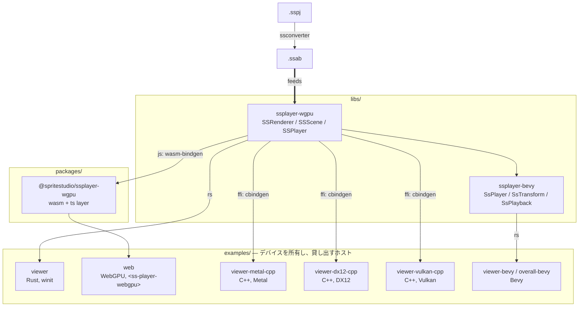

[**English**](./README.md) | [**日本語**](./README.ja.md)

# SpriteStudio Player for wgpu

**Rust のためのプロ品質 2D アニメーション。ネイティブウィンドウからブラウザ、C++ ホストまでを 1 つの wgpu レンダラーで。**

**[SpriteStudio](https://www.webtech.co.jp/spritestudio/)** で制作したアニメーション (`.ssab`) を再生する高性能プレイヤーです。[wgpu](https://wgpu.rs/) の上に構築されています。すでにお持ちのスプライト素材
(PNG / WebP) を専用エディタでアニメーションさせ、WebGPU・Vulkan・DX12・Metal を **1 本**の描画コードパスで再生します。動画ファイルも、作り直しも、エンジンへのロックインもありません。

プレイヤーは wgpu の `Device` / `Queue` / `Surface` を決して所有しません。所有するのはホスト側で、フレームごとに貸し出します。単体ウィンドウ・ブラウザの canvas・C++ ホストのいずれも特別扱いせずに
1 つのライブラリで賄えるのはこの設計によるもので、すでに自前のデバイスを持っているエンジンの内側に同居できるのも同じ理由です。

## 📚 ドキュメント

- [**ドキュメントサイト**](https://cri-middleware.github.io/SSPlayerForWgpu/ja/) — まずはここから。ホストごとの導入経路 (Rust / Bevy / C・C++ / WebGPU)、共通ガイド、各フェイスの API リファレンス、
  WebGPU のライブデモがあります。🚧 このリポジトリの Pages ワークフローが公開されてから有効になります。それまでは `./scripts/build-pages.sh serve=yes` でローカルにビルドするか、
  [`docs/ja/`](./docs/ja/index.md) を直接お読みください
- [**English documentation**](https://cri-middleware.github.io/SSPlayerForWgpu/) — 同じサイトの英語版（リポジトリ内では [`docs/en/`](./docs/en/index.md)）
- [**制限事項と対応範囲**](./docs/ja/limitations.md) — 現在描けるもの、ホスト側に委ねているもの
- [**SS6Player for CPP からの移行**](./docs/ja/migration/from-ss6-cpp.md)
- [**ROADMAP**](./ROADMAP.md) — 実装済みのもの、予定しているもの、意図的に見送ったもの
- [**SpriteStudio Docs（ポータル）**](https://cri-middleware.github.io/SpriteStudio-Docs/ja/) — SDK と全公式 Player の入口 — 🚧 初回リリース後に公開

## 📦 インストール

**アプリケーションで使う場合**はこのまま下へ。ホストを選んで、[使い方](#-使い方)へ。最初の 1 体から先（イベント、パーツ単位の上書き、モーションブレンディング、デバイスロストからの復帰）も同じ道の続きで、[クレートの README](./libs/ssplayer-wgpu) と[ドキュメント](./docs/ja/index.md)にあります。**プレイヤー自体を開発する場合**は[コントリビュート](#-コントリビュート)へ。

> **`SpriteStudio-SDK` リポジトリが private である間は、以下のどの経路でもそのアクセス権が必要です。**
> このプレイヤーは公開済みの C-API 経由ではなく `ssruntime` と `ssab` を Rust クレートとして直接リンクするため、SDK は git submodule として入ります。

### Rust

クレートを git 依存として追加します。submodule のチェックアウトは cargo が行うので、他のツールは要りません:

```toml
[dependencies]
ssplayer-wgpu = { git = "https://github.com/cri-middleware/SSPlayerForWgpu" }
```

> 🚧 **crates.io にはまだありません。** `cargo publish` はバージョン要求を持たない依存を含むクレートを拒否するため、SDK 側のクレートが先に公開されるのを待っています。[ROADMAP](./ROADMAP.md) を参照してください。

**Bevy** アプリの中で使う場合は、代わりにアダプタへ依存してください。プレイヤーを引き込んだ上で、
Bevy 自身の 2d パスにキャラクターを spawn するための 3 つのコンポーネント
(`SsPlayer` / `SsTransform` / `SsPlayback`) を追加します:

```toml
[dependencies]
ssplayer-bevy = { git = "https://github.com/cri-middleware/SSPlayerForWgpu" }
```

対象とする Bevy のラインは一度に 1 本だけです（どのラインかは[アダプタの README](./libs/ssplayer-bevy)
に記載）。Bevy とプレイヤーが単一の `wgpu` に解決される必要があるためで、食い違いは実行時の驚きではなくコンパイルエラーになります。

### C と C++

C フェイスは cdylib / staticlib と、生成されたヘッダです。🚧 **ビルド済みの配布が用意されるまでは**（このブロックの下の注記を参照）、チェックアウトからのビルドがこのホストでの導入経路になります:

```bash
git clone --recursive https://github.com/cri-middleware/SSPlayerForWgpu.git
cd SSPlayerForWgpu
./scripts/build.sh          # Windows では scripts\build.ps1
```

これで C / C++ プロジェクトに必要なものが `bin/` に集まります:

```
bin/include/ssplayer_wgpu.h                              # C ヘッダ (cbindgen)
bin/LICENSE.md
bin/LICENSE.ja.md
bin/THIRD_PARTY_NOTICES.md                               # 謝辞に載せるべきもの
bin/libs/<platform>/<arch>/libssplayer_wgpu.{a,dylib}    # Windows では .lib/.dll
```

ビルド設定をこの 2 つのディレクトリに向けてください。[`examples/`](#-サンプル) 以下の C++ ビューアがまさにそれを CMake で行っており、動く実例としては最短です。macOS では Metal、Windows では DX12、
Linux では Vulkan を駆動し、それぞれ丸ごとコピーして持ち出せる程度に自己完結しています。

> 🚧 **ビルド済みバイナリの配布はまだありません。** 想定している経路は、同じ `bin/` ツリーをプラットフォームごとのアーカイブにして
> [GitHub Releases](https://github.com/cri-middleware/SSPlayerForWgpu/releases) へ置く形で、SDK や他の
> Player の配布方法に揃えます。上記のレイアウトはすでにリリースが同梱する形そのもので、足りていないのはリリースワークフロー、macOS の署名と notarization、そしてチェックサムです。
> [ROADMAP](./ROADMAP.md) を参照してください。

### ブラウザ (WebGPU)

ブラウザ向けフェイスは npm パッケージ
[`@spritestudio/ssplayer-wgpu`](./packages/ssplayer-wgpu) です。wasm と、その上に載る小さな
TypeScript 層で構成されています:

```js
import { sharedContext } from '@spritestudio/ssplayer-wgpu';           // the page's device
import { defineSsPlayerWebGPUElement } from '@spritestudio/ssplayer-wgpu/element';  // <ss-player-webgpu>
```

`SsContextWeb` / `SsSurfaceWeb` / `SsPlayerWeb` が API の全体です（ページごとに 1 デバイス、canvas ごとに
1 サーフェス、1 パスに任意個数のキャラクター）。カスタム要素はその上に載る 1 キャラクター用の簡便なラッパーで、使わないバンドルが抱え込まずに済むよう独立したエントリポイントに分けてあります。
JavaScript 側から読むべき README は[パッケージ自身のもの](./packages/ssplayer-wgpu/README.ja.md)です。

このリポジトリからビルドする場合:

```bash
./scripts/build.sh platform=web     # wasm-pack → packages/ssplayer-wgpu/wasm, tsdown → dist
```

`wasm-pack` に加えて `pnpm` (`corepack enable`) が必要で、そのディレクトリからそのまま publish できる状態になります。同じビルドが [`examples/web`](./examples/web) にも配置されるため、デモは `npm i` で得られるものとまったく同じものを動かしています。wasm 側の実体は `web` フィーチャの下の
`libs/ssplayer-wgpu/src/web.rs` です。

> 🚧 **npm にはまだありません。** パッケージは出荷時の形（スコープ付きの名前、独立したエントリポイントのカスタム要素、専用の README）になっていますが、publish する経路がまだありません。バージョン更新と `npm publish` のステップがこれからです。[ROADMAP](./ROADMAP.md) を参照してください。

## ⚡ 使い方

デバイスごとに `SSRenderer` を 1 つ、レンダーターゲットごとに `SSScene` を 1 つ、そこへ任意個数の
`SSPlayer` を 1 パスで描画します:

```rust
let mut renderer = SSRenderer::new(&device);
let mut scene = SSScene::new(&device, &SceneConfig { color_format, stencil_format, mask: MaskBackend::Stencil });

let mut player = SSPlayer::new();
player.load("assets/overall/Basic.ssab")?;   // pack, atlases and sibling packs, in one call
player.set_animation("anime_1")?;
player.play();

scene.update(&mut renderer, &device, &queue, delta_secs, &mut [&mut player]);
scene.draw(&renderer, &mut rpass);           // into a pass the host opened
```

API の全体 — 3 つのスコープ、ロード、トランスポート、パーツ単位の上書き、イベント、モーションブレンディング、デバイスロストからの復帰 — は[クレートの README](./libs/ssplayer-wgpu) にあります。
C と JavaScript のフェイスは名前が違うだけで同じ形をしており、以下の各サンプルがそれぞれの環境について自分で説明しています。

**1 体のキャラクターに複数のアニメーションを重ねられます。** トラックのスタックがセットアップポーズへ順に畳み込まれます。`set_animation` がトラック 0 を決めて構造を担い、その上に `set_track_animation` /
`set_track_alpha` / `set_track_blend` でオーバーレイを重ねます（下に歩き、上に照準）。`crossfade` を使えばカットなしで別のアニメーションへ移れます。現時点では **Rust API のみ**で、C・JavaScript のフェイスと Bevy アダプタのコンポーネントからは扱えません。モデルと各 API は[モーションブレンディング](./docs/ja/guide/motion-blending.md)にあります。

### その `.ssab` はどこから来るのか

アニメーションは SpriteStudio（**7.5 以上**）で制作し、事前に変換します。このプレイヤーは実行時には何も変換せず、コンバータも同梱しません。デスクトップの
[SSConverterGUI](https://github.com/cri-middleware/SSConverterGUI) か、SDK の `ssconverter-cli` を使ってください。ツールの選び方とビルドパイプラインへの組み込み方は
[単体ツールで変換する](https://cri-middleware.github.io/SpriteStudio-Docs/ja/overview/convert-with-a-standalone-tool/)
にあります。まず試すだけなら自前の素材は要りません。以下のサンプルは SDK 自身のテストアニメーションで動きます。

## 🎬 サンプル

環境ごとにホストが 1 つ（ウィンドウをエンジンが所有する Bevy だけ 2 つ）、それぞれ自己完結しています。どれもその環境の利用ガイドを兼ねた README を持っており、ウィンドウの作り方、デバイスの貸し方、アセットの入れ方が書いてあります。

| サンプル | 環境 | 実行方法 |
|---|---|---|
| [`examples/viewer`](./examples/viewer) | Rust, winit | `cargo run -p ssplayer-wgpu-viewer` |
| [`examples/web`](./examples/web) | ブラウザ上の WebGPU | `./scripts/build.sh platform=web` の後 `cd examples/web && python3 -m http.server` |
| [`examples/viewer-metal-cpp`](./examples/viewer-metal-cpp) | C++ / Metal, macOS | `cmake -B build && cmake --build build && ./build/ssviewer-metal` |
| [`examples/viewer-dx12-cpp`](./examples/viewer-dx12-cpp) | C++ / DX12, Windows | `cmake -B build; cmake --build build --config Release; .\build\Release\ssviewer-dx12.exe` |
| [`examples/viewer-vulkan-cpp`](./examples/viewer-vulkan-cpp) | C++ / Vulkan, Linux — X11 と Wayland を 1 つのバイナリに | `cmake -B build && cmake --build build && ./build/ssviewer-vulkan` |
| [`examples/viewer-bevy`](./examples/viewer-bevy) | Bevy — アダプタの開発用ビューア。全キャラクターを並べたもの | `cargo run -p ssplayer-bevy-viewer` |
| [`examples/overall-bevy`](./examples/overall-bevy) | Bevy — 機能を順に見せるツアー | `cargo run -p ssplayer-bevy-overall` |

再生データは生成物なので、最初に一度これを実行してください:

```bash
./scripts/deploy-examples.sh    # builds ssconverter-cli from the SDK, converts the test projects → assets/
```

C++ ビューアは CMake 経由でライブラリを駆動し、その CMake が cargo 自体を実行するので、別途ビルド手順は要りません。

## 🔨 ソースからのビルド

`scripts/build.sh`（Windows では `build.ps1`）が作るのは**ライブラリだけ**です。`.ssab` の変換は一切行わず、cargo がすでに済ませたチェックアウト以外に SDK を必要としません。

```bash
./scripts/build.sh                            # = platform=host build=release
./scripts/build.sh platform=web build=debug   # wasm + npm package, deployed into examples/web
./scripts/build.sh --help                     # every option
```

| オプション | 値 | 何をするか |
|---|---|---|
| `platform` | `host`（既定）, `web` | `host` は Rust ライブラリと C フェイスをビルドし、`web` は wasm-pack で wasm/js フェイスをビルドします。クロスコンパイルはしないため、`macos`/`windows`/`linux` はホスト自身を指す場合にのみ受け付けます |
| `build` | `release`（既定）, `debug` | cargo のプロファイル。`debug` は `wasm-pack --dev` も意味し、`wasm-opt` を飛ばします — そのサイズを数値として引用しないでください |
| `ffi` | `yes`（既定）, `no` | `host` のみ。`ssplayer-wgpu-ffi` クレートもビルドし、cbindgen で `libs/ssplayer-wgpu-ffi/include/ssplayer_wgpu.h` を再生成します |
| `deploy` | `yes`（既定）, `no` | `web` のみ。ビルドした npm パッケージを `examples/web/ssplayer-wgpu` へコピーします |

cargo を直接使っても構いません。`cargo build -p ssplayer-wgpu-ffi` は収集ステップを除けば同じものです。要件は Rust 1.98 以降、wgpu 29 が対応する GPU バックエンド、web フェイスの場合は加えて
`wasm-pack`・`pnpm`・`rustup target add wasm32-unknown-unknown` です。

**`scripts/deploy-examples.sh`** がもう半分で、再生データを端から端まで受け持ちます。SDK submodule から
`ssconverter-cli` をビルドし、テストプロジェクトを**両方の**エクスポートモードで `assets/` へ変換した上で、
`examples/web` へ `assets/`（参照方式。兄弟の `.png` を伴う）と `assets_emb/`（埋め込み方式。アトラスを焼き込み済み）として配置します。テストは `assets/` を読むため、これは `cargo test` の前提条件であって省略可能な手順ではありません。

## 🧭 リポジトリ構成

単一の Cargo ワークスペースです。ライブラリは 3 つのフェイスすべてを持つ 1 クレートで、もう 1 つのクレートはそれをバイナリにするだけです。それ以外はすべてそれを駆動するホストです。



| パス | 内容 |
|---|---|
| [`libs/ssplayer-wgpu/`](./libs/ssplayer-wgpu) | クレート `ssplayer-wgpu` — プレイヤー本体。ただの `rlib` で、`web` と `ffi` のフェイスはフィーチャの下 |
| [`libs/ssplayer-wgpu-ffi/`](./libs/ssplayer-wgpu-ffi) | クレート `ssplayer-wgpu-ffi` — その 2 つのフェイスを `staticlib` / `cdylib` として出力し（CMake ホストがリンクする C ABI と、`wasm-pack` がビルドする wasm）、`include/ssplayer_wgpu.h` を再生成します。publish しません |
| [`libs/ssplayer-bevy/`](./libs/ssplayer-bevy) | クレート `ssplayer-bevy` — Bevy アダプタ。プレイヤーがエンジンに依存しないよう別クレートにしてあります。対象の Bevy ラインはその README を参照 |
| [`packages/ssplayer-wgpu/`](./packages/ssplayer-wgpu) | npm パッケージ `@spritestudio/ssplayer-wgpu` — wasm と、その上の TypeScript 層 (`.` と `./element`)。この位置から publish します。`wasm/` と `dist/` は gitignore されたビルド生成物 |
| [`examples/`](./examples) | 環境ごとに 1 ホスト。[サンプル](#-サンプル)を参照 |
| `scripts/build.sh` / `.ps1` | ライブラリを 1 プラットフォーム分ビルドし、`bin/` に集めます |
| `scripts/deploy-examples.sh` / `.ps1` | SDK のテストプロジェクトを `assets/` へ変換し、両方のエクスポートモードを `examples/web` に配置します |
| `bin/` | 集約されたライブラリ成果物。gitignore 対象 |
| `SpriteStudio-SDK/` | SDK。git submodule で、`ssruntime` と `ssab` はここへの path 依存 |

クレートのバージョンはそれぞれ独立しています。追いかけている対象が違うためで、プレイヤーは SDK を、
Bevy アダプタは Bevy のリリースラインを追い、ビューア類は製品ではなく開発用ホストです。

## 🤝 コントリビュート

手引きは [CONTRIBUTING.md](./CONTRIBUTING.md) です（制約、バグの報告方法、開発環境の準備、プルリクエスト前に実行することの一覧）。予定しているものと意図的に見送ったものは [ROADMAP.md](./ROADMAP.md) にあります。

SDK は submodule なので、`ssruntime` や `ssab` に手を入れる必要のある変更は、まず向こうへプルリクエストを出し、その後こちらで submodule を更新する形になります。

## 🔗 関連リポジトリ

- [SpriteStudio-SDK](https://github.com/cri-middleware/SpriteStudio-SDK) — `ssruntime` と `ssconverter`
  を提供するコア SDK。
- [SSPlayerForWeb](https://github.com/cri-middleware/SSPlayerForWeb) — Web 向け Player 群。描画の一致を判定する際の基準にしている WebGL レンダラーを含みます。
- [SSConverterGUI](https://github.com/cri-middleware/SSConverterGUI) — `.sspj` を `.ssab` へ変換するデスクトップ GUI ツール。

## 📄 ライセンス

BSD-3-Clause です。[LICENSE.md](./LICENSE.md)（正文）を参照してください。参考訳は
[LICENSE.ja.md](./LICENSE.ja.md) にあります。

本ライブラリは自身も Rust クレート（wgpu とそのバックエンド、FlatBuffers、`image` デコーダなど）をリンクしており、それらのライセンスは皆さんが配布する成果物にも義務を課します。謝辞に何を含めるべきかは
[THIRD_PARTY_NOTICES.md](./THIRD_PARTY_NOTICES.md) にあります。依存関係が変わったときは
`scripts/generate-licenses.sh` で再生成してください。
