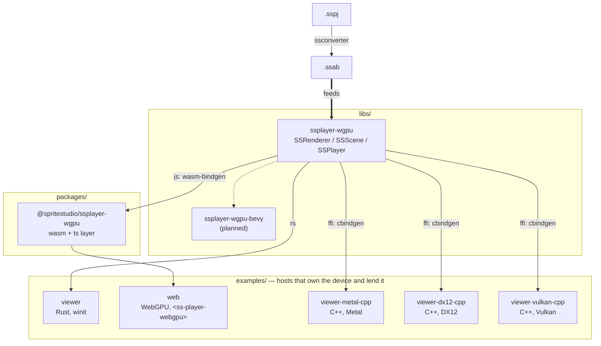

# SSPlayerForWgpu

**Professional 2D animation for Rust — one wgpu renderer, from a native window to the browser to a C++ host.**

A high-performance player for **[OPTPiX SpriteStudio 7](https://www.webtech.co.jp/spritestudio/)**
animations (`.ssab`), built on [wgpu](https://wgpu.rs/). Animate the sprite art you already have
(PNG / WebP) in a dedicated editor, then play it back through **one** rendering code path that covers
WebGPU, Vulkan, DX12 and Metal — no video files, no re-authoring, no engine lock-in.

The player never owns the wgpu `Device` / `Queue` / `Surface`: the host owns them and lends them per
frame. That is what lets one library serve a standalone window, a browser canvas and a C++ host without
any of them being a special case, and what lets it ride along inside an engine that already has a device
of its own.

## 📚 Documentation

- [**Japanese documentation (日本語ドキュメント)**](./docs/ja/index.md)
- [**Migrating from SS6Player for CPP**](./docs/ja/migration_from_cpp.md)
- [**ROADMAP**](./ROADMAP.md) — what is implemented, what is planned, and what was deliberately declined
- [**SpriteStudio Docs (portal)**](https://cri-middleware.github.io/SpriteStudio-Docs/) — the SDK and every
  official player in one place (live with the first release)

## 📦 Installation

> **While the `SpriteStudio-SDK` repository is private, every route below needs access to it.** The
> player links `ssruntime` and `ssab` as Rust crates rather than through a released C-API, so the SDK
> comes in as a git submodule.

### Rust

Add the crate as a git dependency. Cargo checks out the submodule for you, and no other tooling is
needed:

```toml
[dependencies]
ssplayer-wgpu = { git = "https://github.com/cri-middleware/SSPlayerForWgpu" }
```

> 🚧 **Not on crates.io yet.** `cargo publish` refuses a crate whose dependencies have no version
> requirement, so this waits on the SDK crates being published first — see [ROADMAP](./ROADMAP.md).

### C and C++

The C face is a cdylib / staticlib plus a generated header. Build it from this repository:

```bash
git clone --recursive https://github.com/cri-middleware/SSPlayerForWgpu.git
cd SSPlayerForWgpu
./scripts/build.sh          # scripts\build.ps1 on Windows
```

That collects everything a C or C++ project needs into `bin/`:

```
bin/include/ssplayer_wgpu.h                              # the C header (cbindgen)
bin/LICENSE.md
bin/libs/<platform>/<arch>/libssplayer_wgpu.{a,dylib}    # .lib/.dll on Windows
```

Point your build at those two directories. The C++ viewers under [`examples/`](#-samples) do exactly
that through CMake and are the shortest working reference — one drives Metal on macOS, one DX12 on
Windows, one Vulkan on Linux, and each is self-contained enough to copy out whole.

> 🚧 **No prebuilt downloads yet.** The intended route is a per-platform archive of that same `bin/`
> tree on [GitHub Releases](https://github.com/cri-middleware/SSPlayerForWgpu/releases), matching how
> the SDK and the other players ship. The layout above is already what a release would package;
> what is missing is the release workflow, a macOS signing and notarization step, and the checksums —
> see [ROADMAP](./ROADMAP.md).

### Browser (WebGPU)

The browser face is an npm package, [`@spritestudio/ssplayer-wgpu`](./packages/ssplayer-wgpu) — the
wasm plus a small TypeScript layer over it:

```js
import { sharedContext } from '@spritestudio/ssplayer-wgpu';           // the page's device
import { defineSsPlayerWebGPUElement } from '@spritestudio/ssplayer-wgpu/element';  // <ss-player-webgpu>
```

`SsContextWeb` / `SsSurfaceWeb` / `SsPlayerWeb` are the full API — one device per page, one surface
per canvas, any number of characters in one pass — and the custom element is the one-character
convenience wrapper over them, in its own entry point so a bundle that does not use it does not carry
it. The package's own [README](./packages/ssplayer-wgpu/README.md) is the JavaScript-facing one.

Build it from this repository with:

```bash
./scripts/build.sh platform=web     # wasm-pack → packages/ssplayer-wgpu/wasm, tsdown → dist
```

That needs `pnpm` (`corepack enable`) as well as `wasm-pack`, and it publishes from that directory as
it stands. The same build is staged into [`examples/web`](./examples/web), so the demo drives exactly
what an `npm i` gets. The wasm side is `libs/ssplayer-wgpu/src/web.rs`, behind the `web` feature.

> 🚧 **Not on npm yet.** The package now has its shipping shape (scoped name, the element as an entry
> point, its own README), but nothing publishes it: the version bump and the `npm publish` step are
> still to come. See [ROADMAP](./ROADMAP.md).

## ⚡ Usage

One `SSRenderer` per device, one `SSScene` per render target, and any number of `SSPlayer`s drawn into
it in one pass:

```rust
let mut renderer = SSRenderer::new(&device);
let mut scene = SSScene::new(&device, &SceneConfig { color_format, stencil_format });

let mut player = SSPlayer::new();
player.load("assets/overall/Basic.ssab")?;   // pack, atlases and sibling packs, in one call
player.set_animation("Basic")?;
player.play();

scene.update(&mut renderer, &device, &queue, delta_secs, &mut [&mut player]);
scene.draw(&renderer, &mut rpass);           // into a pass the host opened
```

The full API — the three scopes, loading, transport, per-part overrides, events, device-loss recovery —
is in the [crate README](./libs/ssplayer-wgpu). The C and JavaScript faces are the same shape under
different names, and each sample below documents its own.

## 🎬 Samples

One host per environment, each self-contained. Every one has a README that doubles as the usage guide
for that environment: how the window is created, how the device is lent, and how assets get in.

| Sample | Environment | Run it |
|---|---|---|
| [`examples/viewer`](./examples/viewer) | Rust, winit | `cargo run -p ssplayer-wgpu-viewer` |
| [`examples/web`](./examples/web) | WebGPU in a browser | `./scripts/build.sh platform=web`, then `cd examples/web && python3 -m http.server` |
| [`examples/viewer-metal-cpp`](./examples/viewer-metal-cpp) | C++ on Metal, macOS | `cmake -B build && cmake --build build && ./build/ssviewer-metal` |
| [`examples/viewer-dx12-cpp`](./examples/viewer-dx12-cpp) | C++ on DX12, Windows | `cmake -B build; cmake --build build --config Release; .\build\Release\ssviewer-dx12.exe` |
| [`examples/viewer-vulkan-cpp`](./examples/viewer-vulkan-cpp) | C++ on Vulkan, Linux — X11 and Wayland in one binary | `cmake -B build && cmake --build build && ./build/ssviewer-vulkan` |

They play generated animation data, so run this once first:

```bash
./scripts/deploy-examples.sh    # builds ssconverter-cli from the SDK, converts the test projects → assets/
```

The C++ viewers drive the library through CMake, which runs cargo itself, so they need no separate build
step.

## 🔨 Building from source

`scripts/build.sh` (`build.ps1` on Windows) builds the **library** and nothing else — it never converts
a `.ssab`, and it does not need the SDK for anything but the checkout cargo already did.

```bash
./scripts/build.sh                            # = platform=host build=release
./scripts/build.sh platform=web build=debug   # wasm + npm package, deployed into examples/web
./scripts/build.sh --help                     # every option
```

| Option | Values | What it does |
|---|---|---|
| `platform` | `host` (default), `web` | `host` builds the Rust library and the C face; `web` builds the wasm/js face with wasm-pack. It does not cross-compile, so `macos`/`windows`/`linux` are accepted only when they name the host |
| `build` | `release` (default), `debug` | Cargo profile; `debug` also means `wasm-pack --dev`, which skips `wasm-opt` — never quote its size |
| `ffi` | `yes` (default), `no` | `host` only: also build `--features ffi`, which regenerates `libs/ssplayer-wgpu/include/ssplayer_wgpu.h` with cbindgen |
| `deploy` | `yes` (default), `no` | `web` only: copy the built npm package into `examples/web/ssplayer-wgpu` |

Cargo works directly too — `cargo build -p ssplayer-wgpu --features ffi` is the same thing without the
collect step. Requirements are Rust 1.97+, a GPU backend supported by wgpu 29, and for the web face
`wasm-pack`, `pnpm` and `rustup target add wasm32-unknown-unknown`.

**`scripts/deploy-examples.sh`** is the other half, and owns the playback data end to end: it builds
`ssconverter-cli` from the SDK submodule and converts the test projects into `assets/` in **both** export
modes, deploying them to `examples/web` as `assets/` (reference, plus its sibling `.png`) and
`assets_emb/` (embedded, atlas baked in). The tests read `assets/`, so it is a prerequisite for
`cargo test`, not an optional step.

## 🧭 Repository layout

A single Cargo workspace. The library is one crate carrying all three faces; everything else is a host
that drives it.



| Path | What |
|---|---|
| [`libs/ssplayer-wgpu/`](./libs/ssplayer-wgpu) | crate `ssplayer-wgpu` — the player. `rlib` + `cdylib` + `staticlib`, with the `web` and `ffi` faces behind features |
| [`packages/ssplayer-wgpu/`](./packages/ssplayer-wgpu) | npm package `@spritestudio/ssplayer-wgpu` — the wasm plus the TypeScript layer over it (`.` and `./element`). Published from where it sits; `wasm/` and `dist/` are gitignored build outputs |
| [`examples/`](./examples) | one host per environment; see [Samples](#-samples) |
| `scripts/build.sh` / `.ps1` | builds the library for one platform, collecting it into `bin/` |
| `scripts/deploy-examples.sh` / `.ps1` | converts the SDK's test projects into `assets/` and deploys both export modes to `examples/web` |
| `bin/` | collected library artifacts. Gitignored |
| `SpriteStudio-SDK/` | the SDK, as a git submodule — `ssruntime` and `ssab` are path dependencies into it |

The two crates are versioned independently: the library and the development viewer are different
products.

## 🤝 Contributing

[AGENTS.md](./AGENTS.md) records the invariants every change has to respect and how to verify one;
[ROADMAP.md](./ROADMAP.md) is what is planned and what was deliberately declined. A full check is:

```bash
cargo fmt --all -- --check
cargo clippy --workspace --all-targets -- -D warnings
cargo test --workspace                                                  # needs deploy-examples.sh first
cargo build -p ssplayer-wgpu --target wasm32-unknown-unknown --no-default-features --features web
cargo build -p ssplayer-wgpu --features ffi                             # also regenerates the C header
```

The SDK is a submodule, so a change that needs `ssruntime` or `ssab` is a pull request there followed by
a submodule bump here.

## 🔗 Related Repositories

- [SpriteStudio-SDK](https://github.com/cri-middleware/SpriteStudio-SDK) — the core SDK providing
  `ssruntime` and `ssconverter`.
- [SSPlayerForWeb](https://github.com/cri-middleware/SSPlayerForWeb) — the Web players, including the
  WebGL renderer this one is judged for rendering parity against.
- [SSConverterGUI](https://github.com/cri-middleware/SSConverterGUI) — desktop GUI tool for converting
  `.sspj` to `.ssab`.

## 📄 License

BSD-3-Clause. See [LICENSE.md](./LICENSE.md).
