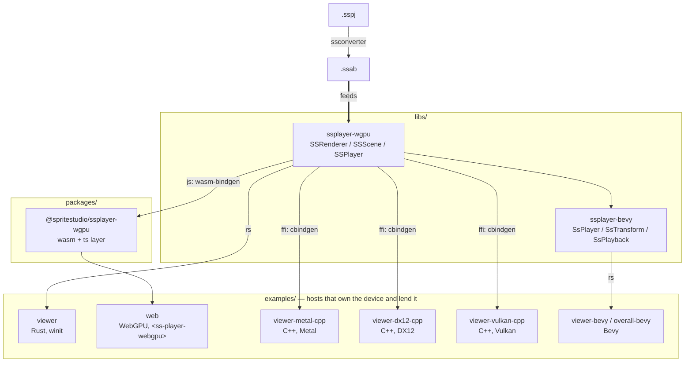

[**English**](./README.md) | [**日本語**](./README.ja.md)

# SpriteStudio Player for wgpu

**Professional 2D animation for Rust — one wgpu renderer, from a native window to the browser to a C++ host.**

A high-performance player for **[SpriteStudio](https://www.webtech.co.jp/spritestudio/)**
animations (`.ssab`), built on [wgpu](https://wgpu.rs/). Animate the sprite art you already have
(PNG / WebP) in a dedicated editor, then play the finished animation in your application — no video
files, no re-authoring, no engine lock-in.

## ✨ Why use SpriteStudio with wgpu?

- **Artist-made motion, not animation code.** Bone rigs, mesh deformation and particle effects are authored visually in SpriteStudio and exported as one `.ssab`. The player plays it, and timeline events and per-part overrides connect it to your game logic.
- **Blend between motions.** Layer animations on tracks and crossfade between them, so a walk eases into a run instead of snapping — see [Motion blending](./docs/en/guide/motion-blending.md).
- **It borrows your GPU; it never owns it.** The host owns the wgpu `Device` / `Queue` / `Surface` and lends them per frame, so the player rides inside any wgpu application — your own, egui, macroquad, Bevy — and a scene of many characters shares one upload of each atlas.
- **Native graphics on every platform.** One wgpu code path draws through DirectX 12 on Windows, Metal on macOS, Vulkan on Linux and WebGPU in the browser.
- **Not just Rust.** From C, C++ or Objective-C it is a static library and one header: hand it your `HWND`, `NSView`, `CAMetalLayer`, X11 `Window` or `wl_surface` and call two functions per frame. In the browser it is a WebAssembly build, and in **Bevy**, `ssplayer-bevy` adds three components that draw a character as part of Bevy's own 2D rendering.
- **Zero-parse loading, SIMD playback.** `.ssab` is a FlatBuffers binary read in place, and poses come from the SDK's `#![no_std]` Rust core with SIMD — the same core every official SpriteStudio player uses.

## 📚 Documentation

- [**Documentation site**](https://cri-middleware.github.io/SSPlayerForWgpu/) — start here: one path per
  host (Rust / Bevy / C・C++ / WebGPU), a shared guide, the API reference for every face, and the
  live WebGPU demo. Its source is [`docs/en/`](./docs/en/index.md) in the repository
- [**日本語ドキュメント**](https://cri-middleware.github.io/SSPlayerForWgpu/ja/) — the same site
  ([`docs/ja/`](./docs/ja/index.md) in the repository)
- [**Limitations & Scope**](./docs/en/limitations.md) — what this player draws today, and what it leaves to the host
- [**Migrating from SS6Player for CPP**](./docs/en/migration/from-ss6-cpp.md)
- [**ROADMAP**](./ROADMAP.md) — what is implemented, what is planned, and what was deliberately declined
- [**For AI assistants**](https://cri-middleware.github.io/SSPlayerForWgpu/llms.txt) — these docs as Markdown: `llms.txt` indexes the pages and `llms-full.txt` holds all of them in one file
- [**SpriteStudio Docs (portal)**](https://cri-middleware.github.io/SpriteStudio-Docs/) — the SDK and every
  official player in one place

## 📦 Installation

**Using it in your application?** Read on — pick your host, then [Usage](#-usage).
Everything after the first character (events, per-part overrides, motion blending,
device-loss recovery) is the same path further in, in the [crate README](./libs/ssplayer-wgpu)
and the [documentation](./docs/en/index.md).
**Working on the player itself?** [Contributing](#-contributing).

> The player links `ssruntime` and `ssab` as Rust crates rather than through a released C-API, so the
> SDK comes in as a git submodule.

### Rust

Add the crate as a git dependency. Cargo checks out the submodule for you, and no other tooling is
needed:

```toml
[dependencies]
ssplayer-wgpu = { git = "https://github.com/cri-middleware/SSPlayerForWgpu" }
```

Inside a **Bevy** app, depend on the adapter instead — it pulls the player in and adds the three
components (`SsPlayer` / `SsTransform` / `SsPlayback`) that draw a character as part of Bevy's own 2D rendering:

```toml
[dependencies]
ssplayer-bevy = { git = "https://github.com/cri-middleware/SSPlayerForWgpu" }
```

It tracks one Bevy line at a time — named in [its README](./libs/ssplayer-bevy) — because Bevy
and the player have to resolve to a single `wgpu`. A mismatch is a compile error, not a runtime
surprise.

### C and C++

The C face is a cdylib / staticlib plus a generated header. Each
[`ssplayer-wgpu` Release](https://github.com/cri-middleware/SSPlayerForWgpu/releases?q=ssplayer-wgpu&expanded=true)
carries the static library as one zip per platform under **Assets** —
`ssplayer-wgpu-windows-x86_64.zip` (MSVC, `/MD` runtime) and `ssplayer-wgpu-macos-universal.zip`
(arm64 + x86_64) — each holding `include/`, `lib/`, `LICENSE.md`, `LICENSE.ja.md` and
`THIRD_PARTY_NOTICES.md`, with `SHA256SUMS` beside them.
[Get started with C / C++](./docs/en/start/cpp.md) covers linking it, and building for the static
runtime (`/MT`).

On Linux, or for the shared library, build it from a checkout:

```bash
git clone --recursive https://github.com/cri-middleware/SSPlayerForWgpu.git
cd SSPlayerForWgpu
./scripts/build.sh          # scripts\build.ps1 on Windows
```

That collects everything a C or C++ project needs into `bin/`:

```
bin/include/ssplayer_wgpu.h                              # the C header (cbindgen)
bin/LICENSE.md
bin/LICENSE.ja.md
bin/THIRD_PARTY_NOTICES.md                               # what to carry into your acknowledgements
bin/libs/<platform>/<arch>/libssplayer_wgpu.{a,dylib}    # .lib/.dll on Windows
```

Point your build at those two directories. The C++ viewers under [`examples/`](#-samples) do exactly
that through CMake and are the shortest working reference — one drives Metal on macOS, one DX12 on
Windows, one Vulkan on Linux, and each is self-contained enough to copy out whole.

### Browser (WebGPU)

The browser face is an npm package, [`@spritestudio/ssplayer-wgpu`](./packages/ssplayer-wgpu) — the
wasm plus a small TypeScript layer over it:

```js
import { sharedContext } from '@spritestudio/ssplayer-wgpu';           // the page's device
import { defineSsPlayerWebGPUElement } from '@spritestudio/ssplayer-wgpu/element';  // <ss-player-webgpu>
```

`SsContextWeb` / `SsSurfaceWeb` / `SsPlayerWeb` are the full API — one device per page, one surface
per canvas, any number of characters in one pass — and the custom element is the one-character
convenience wrapper over them, in its own entry point so a bundle that does not use it does not carry
it. The package's own [README](./packages/ssplayer-wgpu/README.md) is the JavaScript-facing one.

Install it from npm:

```bash
npm i @spritestudio/ssplayer-wgpu@beta
```

To build it from this repository instead:

```bash
./scripts/build.sh platform=web     # wasm-pack → packages/ssplayer-wgpu/wasm, tsdown → dist
```

That needs `pnpm` (`corepack enable`) as well as `wasm-pack`, and it publishes from that directory as
it stands. The same build is staged into [`examples/web`](./examples/web), so the demo drives exactly
what an `npm i` gets. The wasm side is `libs/ssplayer-wgpu/src/web.rs`, behind the `web` feature.

## ⚡ Usage

One `SSRenderer` per device, one `SSScene` per render target, and any number of `SSPlayer`s drawn into
it in one pass:

```rust
let mut renderer = SSRenderer::new(&device);
let mut scene = SSScene::new(&device, &SceneConfig { color_format, stencil_format, mask: MaskBackend::Stencil });

let mut player = SSPlayer::new();
player.load("assets/overall/Basic.ssab")?;   // pack, atlases and sibling packs, in one call
player.set_animation("anime_1")?;
player.play();

scene.update(&mut renderer, &device, &queue, delta_secs, &mut [&mut player]);
scene.draw(&renderer, &mut rpass);           // into a pass the host opened
```

The full API — the three scopes, loading, transport, per-part overrides, events, motion blending,
device-loss recovery — is in the [crate README](./libs/ssplayer-wgpu). The C and JavaScript faces are
the same shape under different names, and each sample below documents its own.

**Several animations on one character.** A stack of tracks folds onto the setup pose: `set_animation`
establishes track 0 and carries the structure, and `set_track_animation` / `set_track_alpha` /
`set_track_blend` lay overlays above it — a walk underneath, an aim on top — with `crossfade` moving
between two without a cut. Every face has it: the C and JavaScript faces under their own names, and
the Bevy adapter through the `SsTrackCommand` message, with track 0 crossfading when
`SsPlayer::animation` changes under a `transition_ms`. The model and the calls are in
[Motion blending](./docs/en/guide/motion-blending.md).

### Where that `.ssab` comes from

Animations are authored in SpriteStudio — **7.5 or later** — and converted ahead of time; this player
converts nothing at runtime and bundles no converter. Use the desktop
[SSConverterGUI](https://github.com/cri-middleware/SSConverterGUI), or the SDK's `ssconverter-cli`;
[Converting with a standalone tool](https://cri-middleware.github.io/SpriteStudio-Docs/overview/convert-with-a-standalone-tool/)
covers picking one and putting it in a build pipeline. Nothing of your own is needed to try the player
first — the samples below run on the SDK's own test animations.

## 🎬 Samples

One host per environment — two for Rust, the smallest one beside the development viewer, and two for Bevy, where the engine owns the window — each self-contained. Every
one has a README that doubles as the usage guide for that environment: how the window is created, how
the device is lent, and how assets get in.

| Sample | Environment | Run it |
|---|---|---|
| [`examples/hello`](./examples/hello) | Rust, winit — the smallest host, one character | `cargo run -p ssplayer-wgpu-hello` |
| [`examples/viewer`](./examples/viewer) | Rust, winit — the development viewer, a live cast | `cargo run -p ssplayer-wgpu-viewer` |
| [`examples/web`](./examples/web) | WebGPU in a browser | `./scripts/run-web.sh` |
| [`examples/cdn`](./examples/cdn) | WebGPU in a browser, the npm package straight from jsDelivr — no build step | `cd examples/cdn && python3 -m http.server` |
| [`examples/viewer-metal-cpp`](./examples/viewer-metal-cpp) | C++ on Metal, macOS | `cmake -B build && cmake --build build && ./build/ssviewer-metal` |
| [`examples/viewer-dx12-cpp`](./examples/viewer-dx12-cpp) | C++ on DX12, Windows | `cmake -B build; cmake --build build --config Release; .\build\Release\ssviewer-dx12.exe` |
| [`examples/viewer-vulkan-cpp`](./examples/viewer-vulkan-cpp) | C++ on Vulkan, Linux — X11 and Wayland in one binary | `cmake -B build && cmake --build build && ./build/ssviewer-vulkan` |
| [`examples/viewer-bevy`](./examples/viewer-bevy) | Bevy — the adapter's development viewer, a live cast | `cargo run -p ssplayer-bevy-viewer` |
| [`examples/overall-bevy`](./examples/overall-bevy) | Bevy — the scripted feature tour | `cargo run -p ssplayer-bevy-overall` |

From a fresh checkout, one script converts the data on its first run and then starts a sample —
`hello` unless you name another (`.ps1` on Windows):

```bash
./scripts/run-example.sh                  # example=viewer / viewer-bevy / overall-bevy / web
./scripts/run-web.sh                      # the browser demo: builds the package if missing, serves and opens it
```

Running one by hand, as in the table, needs the generated animation data first:

```bash
./scripts/deploy-examples.sh    # builds ssconverter-cli from the SDK, converts the test projects → assets/
```

The C++ viewers drive the library through CMake, which runs cargo itself, so they need no separate build
step.

## 🛠️ Building from Source

`scripts/build.sh` (`build.ps1` on Windows) builds the **library** and nothing else — it never converts
a `.ssab`, and it does not need the SDK for anything but the checkout cargo already did.

```bash
./scripts/build.sh                            # = platform=host build=release
./scripts/build.sh platform=web build=debug   # wasm + npm package, deployed into examples/web
./scripts/build.sh --help                     # every option
```

| Option | Values | What it does |
|---|---|---|
| `platform` | `host` (default), `web` | `host` builds the Rust library and the C face; `web` builds the wasm/js face with wasm-pack. It does not cross-compile, so `macos`/`windows`/`linux` are accepted only when they name the host |
| `build` | `release` (default), `debug` | Cargo profile; `debug` also means `wasm-pack --dev`, which skips `wasm-opt` — never quote its size |
| `ffi` | `yes` (default), `no` | `host` only: also build the `ssplayer-wgpu-ffi` crate, which regenerates `libs/ssplayer-wgpu-ffi/include/ssplayer_wgpu.h` with cbindgen |
| `deploy` | `yes` (default), `no` | `web` only: copy the built npm package into `examples/web/ssplayer-wgpu` |

Cargo works directly too — `cargo build -p ssplayer-wgpu-ffi` is the same thing without the
collect step. Requirements are Rust 1.99+, a GPU backend supported by wgpu 30, and for the web face
`wasm-pack`, `pnpm` and `rustup target add wasm32-unknown-unknown`.

**`scripts/deploy-examples.sh`** is the other half, and owns the playback data end to end: it builds
`ssconverter-cli` from the SDK submodule and converts the test projects into `assets/` in **both** export
modes, deploying them to `examples/web` as `assets/` (reference, plus its sibling `.png`) and
`assets_emb/` (embedded, atlas baked in). The tests read `assets/`, so it is a prerequisite for
`cargo test`, not an optional step.

## 🧭 Repository Layout

A single Cargo workspace. The library is one crate carrying all three faces, which a second crate only
builds into binaries; everything else is a host that drives it.



| Path | What |
|---|---|
| [`libs/ssplayer-wgpu/`](./libs/ssplayer-wgpu) | crate `ssplayer-wgpu` — the player, a plain `rlib`, with the `web` and `ffi` faces behind features |
| [`libs/ssplayer-wgpu-ffi/`](./libs/ssplayer-wgpu-ffi) | crate `ssplayer-wgpu-ffi` — emits those two faces as `staticlib` / `cdylib` (the C ABI CMake hosts link, and the wasm `wasm-pack` builds) and regenerates `include/ssplayer_wgpu.h`. Not published |
| [`libs/ssplayer-bevy/`](./libs/ssplayer-bevy) | crate `ssplayer-bevy` — the Bevy adapter. Its own crate, so the player never depends on an engine; see its README for the Bevy line it tracks |
| [`packages/ssplayer-wgpu/`](./packages/ssplayer-wgpu) | npm package `@spritestudio/ssplayer-wgpu` — the wasm plus the TypeScript layer over it (`.` and `./element`). Published from where it sits; `wasm/` and `dist/` are gitignored build outputs |
| [`examples/`](./examples) | one host per environment; see [Samples](#-samples) |
| `scripts/build.sh` / `.ps1` | builds the library for one platform, collecting it into `bin/` |
| `scripts/deploy-examples.sh` / `.ps1` | converts the SDK's test projects into `assets/` and deploys both export modes to `examples/web` |
| `scripts/run-example.sh` / `.ps1`, `run-web.sh` / `.ps1` | take a fresh checkout to a running sample, converting and building only what is missing or what an SDK bump left stale |
| `bin/` | collected library artifacts. Gitignored |
| `SpriteStudio-SDK/` | the SDK, as a git submodule — `ssruntime` and `ssab` are path dependencies into it |

The crates are versioned independently, because they track different things: the player tracks the
SDK, the Bevy adapter tracks Bevy's release line, and the viewers are development hosts rather than
products.

## 🤝 Contributing

[CONTRIBUTING.md](./CONTRIBUTING.md) is the guide — the constraints, how to report a bug, how to set
the environment up, and the full matrix of what to run before opening a pull request.
[ROADMAP.md](./ROADMAP.md) is what is planned and what was deliberately declined.

The SDK is a submodule, so a change that needs `ssruntime` or `ssab` is a pull request there followed by
a submodule bump here.

## 🔗 Related Repositories

- [SpriteStudio-SDK](https://github.com/cri-middleware/SpriteStudio-SDK) — the core SDK providing
  `ssruntime` and `ssconverter`.
- [SSPlayerForWeb](https://github.com/cri-middleware/SSPlayerForWeb) — the Web players, including the
  WebGL renderer this one is judged for rendering parity against.
- [SSConverterGUI](https://github.com/cri-middleware/SSConverterGUI) — desktop GUI tool for converting
  `.sspj` to `.ssab`.

## 📄 License

BSD-3-Clause. See [LICENSE.md](./LICENSE.md).

The library also links Rust crates of its own — wgpu and its backends, FlatBuffers, the `image`
decoder — whose licences carry attribution obligations onto whatever you ship. What to include is in
[THIRD_PARTY_NOTICES.md](./THIRD_PARTY_NOTICES.md), which `scripts/generate-licenses.sh` regenerates
from the dependency tree.
