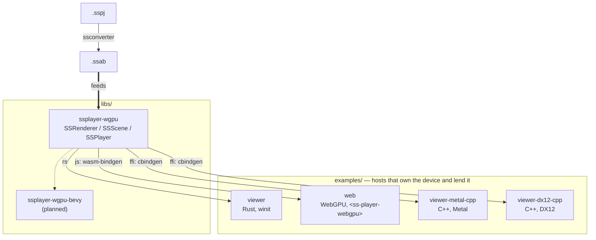

# SSPlayerForWgpu

**Professional 2D animation for Rust — one wgpu renderer, from a native window to the browser to a C++ host.**

A high-performance player for **[OPTPiX SpriteStudio 7](https://www.webtech.co.jp/spritestudio/)**
animations (`.ssab`), built on [wgpu](https://wgpu.rs/). Animate the sprite art you already have
(PNG / WebP) in a dedicated editor, then play it back through **one** rendering code path that covers
WebGPU, Vulkan, DX12, Metal and GL — no video files, no re-authoring, no engine lock-in.

## 📚 Documentation

- [**Japanese documentation (日本語ドキュメント)**](./docs/ja/index.md)
- [**Migrating from SS6Player for CPP**](./docs/ja/migration_from_cpp.md)
- [**ROADMAP**](./ROADMAP.md) — what is implemented, what is planned, and what was deliberately declined
- [**SpriteStudio Docs (portal)**](https://cri-middleware.github.io/SpriteStudio-Docs/) — the SDK and every
  official player in one place (live with the first release)

### Where to read, by goal

You only need to read as far as your goal requires — each row builds one layer more than the row above:

| You are… | You build… | Where to read |
|---|---|---|
| **A library user** | nothing — you consume the library as a dependency or a prebuilt artifact | [Track A](#a-use-the-library) → the example for your environment under [Samples](#-samples) |
| **A customizing user** | the library itself, to change or extend it | Above + [Track B](#b-build-the-library) + [`libs/ssplayer-wgpu`](./libs/ssplayer-wgpu) (the API) |
| **A player developer** | everything — SDK submodule, sample assets, every example, the tests | Above + [Track C](#c-build-everything) → [Overview](#-overview) → [AGENTS.md](./AGENTS.md) |

## 🎯 Which environment am I in?

Each example is a complete host for one environment, and its README is the usage guide for that
environment — how the window is created, how the device is lent, how assets get in.

| Your environment | Start from | What it shows |
|---|---|---|
| **A Rust app** (your own wgpu app, egui, macroquad, Bevy) | [`examples/viewer`](./examples/viewer) | winit + wgpu owning the device and lending it per frame |
| **A browser** (WebGPU) | [`examples/web`](./examples/web) | the `<ss-player-webgpu>` element, and N characters on one canvas |
| **macOS / Metal, from C++** | [`examples/viewer-metal-cpp`](./examples/viewer-metal-cpp) | Cocoa `CAMetalLayer` → the C API |
| **Windows / DX12, from C++** | [`examples/viewer-dx12-cpp`](./examples/viewer-dx12-cpp) | Win32 `HWND` → the C API |
| **Building your own integration** | [`libs/ssplayer-wgpu`](./libs/ssplayer-wgpu) | the crate itself: `SSRenderer` / `SSScene` / `SSPlayer` |
| **Converting `.sspj` → `.ssab`** | [SSConverterGUI](https://github.com/cri-middleware/SSConverterGUI/releases) | or `scripts/deploy-examples.sh` for this repo's sample data |

## 🚀 Quick Start

Three tracks, each one layer deeper than the last. Stop at the one that matches your goal.

### A. Use the library

Nothing to build here. In Rust, add it as a git dependency — cargo checks out the `SpriteStudio-SDK`
submodule for you:

```toml
[dependencies]
ssplayer-wgpu = { git = "https://github.com/cri-middleware/SSPlayerForWgpu" }
```

Then create one `SSRenderer` per device, one `SSScene` per render target, and any number of `SSPlayer`s —
the [crate README](./libs/ssplayer-wgpu#usage) has the whole call sequence, and
[`examples/viewer`](./examples/viewer) is a complete host you can read top to bottom.

> 🚧 **Prebuilt artifacts are not published yet** — no crates.io release, no npm package, no binary
> downloads for the C/C++ face. Until then, the git dependency above is the ready-made route for Rust,
> and everyone else takes Track B. Progress is tracked in the [ROADMAP](./ROADMAP.md).
>
> Building against this crate needs access to the `SpriteStudio-SDK` repository, because it is consumed
> as a submodule rather than as a released package.

### B. Build the library

For changing or extending the player, and the current route to the C/C++ and web faces.

**Prerequisites:** [Rust](https://rustup.rs/) 1.97+, a GPU backend supported by wgpu 29, and access to
the SDK repository. For the web face also `wasm-pack` and `rustup target add wasm32-unknown-unknown`.

```bash
git clone --recursive https://github.com/cri-middleware/SSPlayerForWgpu.git
cd SSPlayerForWgpu
git submodule update --init            # if you cloned without --recursive

./scripts/build.sh                     # the Rust library + the C face → bin/
./scripts/build.sh platform=web        # the wasm/js face → pkg/
```

`build.sh` builds **only the library**; it never converts a `.ssab`. What it produces lands in a fixed
layout, so a packaging step never has to know where each toolchain drops its files:

```
bin/include/ssplayer_wgpu.h                              # the C header (cbindgen)
bin/LICENSE.md
bin/libs/<platform>/<arch>/libssplayer_wgpu.{a,dylib}    # .lib/.dll on Windows
pkg/                                                     # platform=web: the wasm-pack package
```

| Option | Values | What it does |
|---|---|---|
| `platform` | `host` (default), `web` | `host` builds the Rust library and the C face; `web` builds the wasm/js face with wasm-pack. It does not cross-compile, so `macos`/`windows`/`linux` are accepted only when they name the host |
| `build` | `release` (default), `debug` | Cargo profile; `debug` also means `wasm-pack --dev`, which skips `wasm-opt` — never quote its size |
| `ffi` | `yes` (default), `no` | `host` only: also build `--features ffi`, which regenerates `libs/ssplayer-wgpu/include/ssplayer_wgpu.h` with cbindgen |
| `deploy` | `yes` (default), `no` | `web` only: copy the wasm package into `examples/web/wasm` |

`./scripts/build.sh --help` lists them all. On Windows use `scripts\build.ps1` with the same arguments.

### C. Build everything

For working on this repository: the sample data, every example, and the tests.

```bash
./scripts/deploy-examples.sh           # build ssconverter-cli, convert the SDK's test projects → assets/
cargo run -p ssplayer-wgpu-viewer      # the native winit viewer
cargo test --workspace                 # includes headless GPU readback tests
```

`deploy-examples.sh` owns the playback data end to end — it converts the test projects in **both**
export modes and deploys them to `examples/web`: `assets/` (reference, plus its sibling `.png`) and
`assets_emb/` (embedded, atlas baked in), because the demo page has a selector for the two. The tests
read `assets/`, so this is a prerequisite rather than an optional step.

The viewer plays `assets/overall`. Right/Left switches `.ssab` packs, Up/Down switches animations, Space
pauses, `F` flips the Y axis, `+`/`-` changes how many characters share the pass, and `Tab` moves focus
between them. Dropping a `.ssab` file or a folder onto the window plays your own assets — see its
[README](./examples/viewer) for the rest.

## 🎬 Samples

One host per environment, each self-contained — copy a directory out and it builds. Every one has a
README that doubles as the usage guide for that environment; all of them need Track C's
`deploy-examples.sh` first, since they play the generated `assets/`.

| Sample | Run it |
|---|---|
| [`examples/viewer`](./examples/viewer) — Rust, winit | `cargo run -p ssplayer-wgpu-viewer` |
| [`examples/web`](./examples/web) — WebGPU in a browser | `./scripts/build.sh platform=web` then `cd examples/web && python3 -m http.server` → http://localhost:8000 |
| [`examples/viewer-metal-cpp`](./examples/viewer-metal-cpp) — C++ on Metal | `cd examples/viewer-metal-cpp && cmake -B build && cmake --build build && ./build/ssviewer-metal` |
| [`examples/viewer-dx12-cpp`](./examples/viewer-dx12-cpp) — C++ on DX12 | `cd examples\viewer-dx12-cpp; cmake -B build; cmake --build build --config Release; .\build\Release\ssviewer-dx12.exe` |

The C/C++ viewers drive the same `ffi` library through CMake, which runs cargo itself — no separate
library build step is needed for them.

## 💡 Overview

Everything below is for working *on* this repository rather than with it.

### Repository structure

A single Cargo workspace. The library is one crate carrying all three faces; everything else is a host
that drives it.



| Path | What |
|---|---|
| [`libs/ssplayer-wgpu/`](./libs/ssplayer-wgpu) | crate `ssplayer-wgpu` — the player. `rlib` + `cdylib` + `staticlib`, with the `web` and `ffi` faces behind features |
| [`examples/viewer/`](./examples/viewer) | crate `ssplayer-wgpu-viewer` — native winit viewer used for development |
| [`examples/web/`](./examples/web) | `<ss-player-webgpu>` custom element + WebGPU demo page |
| [`examples/viewer-metal-cpp/`](./examples/viewer-metal-cpp) | Cocoa/Objective-C++ viewer driving the C API on Metal |
| [`examples/viewer-dx12-cpp/`](./examples/viewer-dx12-cpp) | Win32/C++ viewer driving the C API on DX12 |
| `scripts/build.sh` / `.ps1` | builds the library for one platform (`platform=host\|web`), collecting it into `bin/` |
| `scripts/deploy-examples.sh` / `.ps1` | converts the SDK's test projects into `assets/` and deploys both export modes to `examples/web` |
| `bin/` | collected library artifacts. Gitignored |
| `SpriteStudio-SDK/` | the SDK, as a git submodule — `ssruntime` and `ssab` are path dependencies into it |

The two crates are versioned independently: the library and the development viewer are different
products.

### The load-bearing design decision

The player never owns the wgpu `Device` / `Queue` / `Surface` — the host owns them and lends them per
frame. That is what lets one library serve a standalone window, a browser canvas and a C++ host without
any of them being a special case, and what lets it ride along inside an engine that already has its own
device. See [`libs/ssplayer-wgpu/README.md`](./libs/ssplayer-wgpu/README.md).

## 🔗 Related Repositories

- [SpriteStudio-SDK](https://github.com/cri-middleware/SpriteStudio-SDK) — the core SDK providing
  `ssruntime` and `ssconverter`.
- [SSPlayerForWeb](https://github.com/cri-middleware/SSPlayerForWeb) — the Web players, including the
  WebGL renderer this one is judged for rendering parity against.
- [SSConverterGUI](https://github.com/cri-middleware/SSConverterGUI) — desktop GUI tool for converting
  `.sspj` to `.ssab`.

## 📄 License

BSD-3-Clause. See [LICENSE.md](./LICENSE.md).

Need help? Open an issue. Contributors should start with [AGENTS.md](./AGENTS.md), which records the
invariants every change has to respect, and [ROADMAP.md](./ROADMAP.md) for what is planned.
