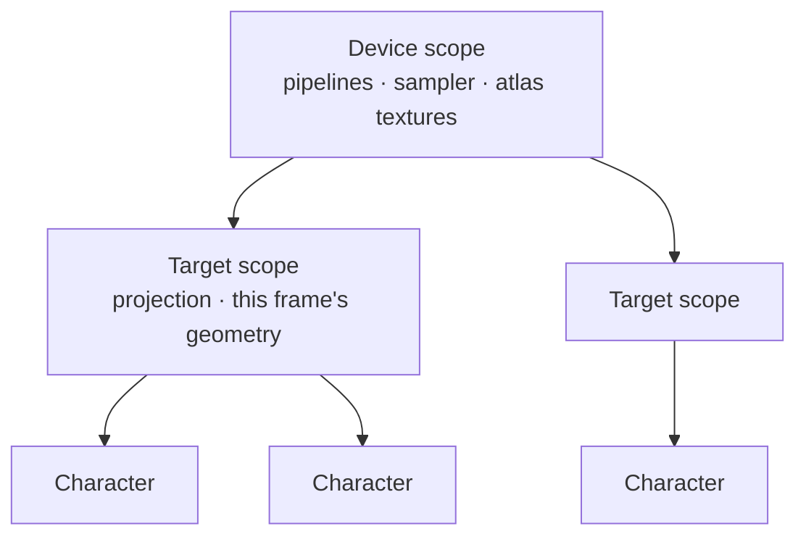

# Scopes and names

Everything from here on is one text for four faces. The vocabulary differs; the model does not.
This page is the bridge — read it once and every other Guide page reads in your language.

!!! tip "Pick your language once"
    Code below appears in tabs. The one you pick is remembered for **every** page on this site, so
    you never choose twice.

## Three scopes

The player splits its state by *how long the thing it holds stays useful*, not by object hierarchy.



| Scope | Holds | You keep one per |
|---|---|---|
| **Device** | pipelines, bind group layouts, the sampler, atlas textures | GPU device — never one per window |
| **Target** | the projection, the frame's geometry arena, the draw list | thing you draw into: a window, a canvas, an offscreen texture |
| **Character** | the playback tree, transform, draw order, visibility, alpha | character on screen |

The consequence that matters in practice: **a character holds no GPU resource at all**. Ten
characters in one target share one atlas upload, one set of pipelines and one render pass. Putting
a second character on screen costs a playback tree and nothing else.

## The same three, named per face

| Scope | Rust | C | JavaScript | Bevy |
|---|---|---|---|---|
| Device | `SSRenderer` | *(inside `ss_scene_t`)* | `SsContextWeb` | *(inside the plugin)* |
| Target | `SSScene` | `ss_scene_t` | `SsSurfaceWeb` | *(the camera's view)* |
| Character | `SSPlayer` | `ss_player_t` | `SsPlayerWeb` | an entity with `SsPlayer` |

Two asymmetries change what is cheap:

* **C fuses the device and target scopes into `ss_scene_t`.** That handle is a whole graphics
  stack built on the window you named — so *one window is one device*. Two windows in one C++
  application are two devices. Two **characters** in one window are one device, which is what the
  `ss_scene_t` / `ss_player_t` split is for.
* **JavaScript keeps them apart**, so a page with eight `<ss-player-webgpu>` elements still builds
  exactly one `GPUDevice`: `SsContextWeb` is the page, `SsSurfaceWeb` is a canvas.

## The frame, in each language

The shape is identical: **advance everything, then draw everything, once.**

=== "Rust"

    ```rust
    scene.update(&mut renderer, &device, &queue, delta_secs, &mut [&mut a, &mut b]);
    scene.encode_mask_coverage(&mut renderer, &device, &mut encoder); // no-op under Stencil
    let mut rpass = encoder.begin_render_pass(&descriptor);
    scene.draw(&renderer, &mut rpass);
    ```

=== "C"

    ```c
    ss_scene_update(scene, delta_seconds);   /* every player this scene owns */
    ss_scene_render(scene);                  /* one pass, then present */
    ```

=== "JavaScript"

    ```js
    surface.frame(dt);   // updates every player on this canvas and draws them in one pass
    ```

=== "Bevy"

    ```rust
    // Nothing. The plugin's systems run in Bevy's Core2d MainPass, after
    // main_transparent_pass_2d, once per frame.
    ```

**Pass every character of a target through one update.** Splitting them across two updates or two
passes is what turns one atlas upload into two — and, where masks are involved, lets one
character's mask clip the next.

Draw order inside a target is `set_order`, ascending. It is a plain integer, not a tree.

## What each face can do

The library is one; the faces expose different amounts of it. Nothing here is a permanent
boundary except the wgpu column — see the [ROADMAP](https://github.com/cri-middleware/SSPlayerForWgpu/blob/main/ROADMAP.md)
for what is planned.

| | Rust | C | JavaScript | Bevy |
|---|:--:|:--:|:--:|:--:|
| [Load, both export modes, sibling packs](./loading.md) | ✅ | ✅ | ✅ | ✅ |
| [Transport: play / pause / resume / stop / seek](./playback.md) | ✅ | ✅ | ✅ | partial |
| [Loop count, sections, direction, sub-frame](./playback.md) | ✅ | ✅ | ✅ | — |
| [Events: user data, signal, audio](./events.md) | ✅ | ✅ | ✅ | ✅ |
| [Part overrides: visibility, cell, colour](./part-overrides.md) | ✅ | ✅ | ✅ | — |
| [Texture replacement: a whole cell map](./texture-replacement.md) | ✅ | ✅ | ✅ | ✅ |
| [Part transform lookup](./part-overrides.md#reading-a-parts-transform) | ✅ | ✅ | ✅ | — |
| [Motion blending: tracks, crossfade](./motion-blending.md) | ✅ | — | — | — |
| [Masks — stencil](./masks.md) | ✅ | ✅ | ✅ | — |
| [Masks — coverage bitmap](./masks.md) | ✅ | — | — | ✅ |
| [Supplying your own textures](./loading.md#supplying-textures-yourself) | ✅ | ✅ | ✅ | — |
| [Device-loss recovery](./device-loss.md) | ✅ | ✅ | ✅ | ✅ |
| [Frame statistics](./performance.md) | ✅ | ✅ | ✅ | — |
| Drawing into a render pass you own | ✅ | — | — | ✅ |

**[Motion blending](./motion-blending.md) is Rust-only today.** From the other faces, layer several
characters and order them with `set_order` instead.

## Two calls, not one: selecting and starting

On every face, **choosing an animation and starting it are separate**:

=== "Rust"

    ```rust
    player.set_animation("attack")?;  // builds the instance tree — the allocating step
    player.play();                    // allocation-free transport
    ```

=== "C"

    ```c
    ss_player_set_animation(player, "attack");
    ss_player_play(player);
    ```

=== "JavaScript"

    ```js
    player.setAnimation('attack');
    player.play();
    ```

=== "Bevy"

    ```rust
    // Setting SsPlayer::animation rebuilds the tree; SsPlayback::playing is the transport.
    ```

That split is deliberate: switching motions is frequent and must not carry an allocation you did
not ask for, or a promise you have to await. See [Playback and transport](./playback.md) for what
each verb does — in particular why `play()` is **not** how you lift a `pause()`.
