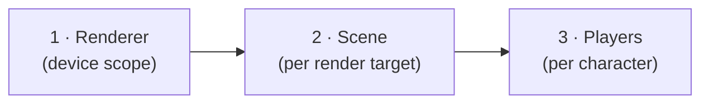

# Device loss

A GPU device can be taken away while your application is running: a driver update, a laptop
switching GPUs, a backgrounded browser tab, a GPU-process crash. Every face of this player can come
back from it without reloading a single `.ssab`.

## The rule: rebuild outward

Recovery is three steps, **in this order**, on a new device:



1. **`SSRenderer::restore_device`** — pipelines, sampler, bind group layouts.
2. **`SSScene::restore_device`** — the projection uniform and frame buffers, per target.
3. **`SSPlayer::restore_textures`** — every character re-registers its atlases.

The order is forced: a character registers its atlases *into the renderer*, so the renderer has to
exist on the new device before anything can hand it a texture.

Playback state — the current frame, the loop count, transport — is CPU-side and never went
anywhere. Nothing rewinds.

A texture you registered with `SSRenderer::set_texture` (Rust) or `addTextureFromBitmap`
(JavaScript) is yours to repair: nothing keeps its pixels, so register it again once the renderer
is restored. Textures from `upload_texture` with `Retention::Retain`, `addTexture`,
`addTextureFromBytes`, `ss_scene_add_texture*` and everything `load` fetched come back on their
own, and embedded atlases are decoded again from the `.ssab` in step 3.

## Per face

=== "Rust"

    ```rust
    // wgpu reports the loss through Device::set_device_lost_callback. Request a new
    // adapter and device, then, in this order:
    renderer.restore_device(&device, &queue);
    scene.restore_device(&device, &queue);
    for player in &mut players {
        player.restore_textures(&mut renderer, &device, &queue);
    }
    ```

    A Rust host that used `NativeHost` (a raw window handle rather than its own wgpu setup) gets
    `NativeHost::restore_device()`, which wraps the whole sequence.

=== "C"

    ```c
    if (ss_scene_is_device_lost(scene)) {
        if (ss_scene_restore_device(scene) != SS_OK) {
            fprintf(stderr, "%s\n", ss_last_error());
        }
    }
    ```

    While the device is lost, `ss_scene_update` and `ss_scene_render` do nothing and
    `ss_scene_resize` only records the size — so a host that never checks simply shows a frozen
    window rather than crashing.

=== "JavaScript"

    ```js
    import { restoreSharedDevice } from '@spritestudio/ssplayer-wgpu';

    if (ctx.isDeviceLost()) {
      await restoreSharedDevice(ctx);   // every canvas and every player on the page
    }
    ```

    Check it in your frame loop. Every surface and player is rebuilt from its retained source and
    playback resumes where it stopped. **`<ss-player-webgpu>` does this for you.**

=== "Bevy"

    Recovery rides Bevy's own: on a new device Bevy re-runs `RenderStartup`, which rebuilds the
    renderer, and the characters reload from the main world on the next frame. They start their
    animations from the head: the frame, the loop count and the track stack are not carried over,
    and `SsStarted` arrives again.

    **You must opt in.** Bevy's default error handler *quits* on device loss. Install a
    `RenderErrorHandler` that answers a `DeviceLost` error with
    `RenderErrorPolicy::Recover(RenderCreation::default())`:

    ```rust
    use bevy::render::{
        error_handler::{ErrorType, RenderErrorHandler, RenderErrorPolicy},
        settings::RenderCreation,
    };

    app.insert_resource(RenderErrorHandler(|error, main_world, render_world| {
        if matches!(error.ty, ErrorType::DeviceLost) {
            RenderErrorPolicy::Recover(RenderCreation::default())
        } else {
            (RenderErrorHandler::default().0)(error, main_world, render_world) // Bevy's own: log and quit
        }
    }));
    ```

## What is not recoverable

**A change of colour format is not a device loss and cannot be recovered in place.** The scene's
pipelines are baked against the format it was built with, so a new format means a new `SSScene`.

(The Bevy adapter has one exception it handles for you: a camera switching to HDR changes the view
format, and the scene rebuilds its pipelines on the frame that happens — mask pipelines included.)

## Testing it

There is no portable "lose the device now" call, and the JavaScript face does not hand out the
page's `GPUDevice` to call `destroy()` on. A driver reset, or switching the discrete/integrated GPU
while running, loses the device — under a native host and in a browser tab alike. Try it once before shipping: unhandled, this shows up as a frozen or blank window
on someone else's machine.

## Next

* [The borrow model](../wgpu/borrow-model.md) — why recovery has this shape
* [Performance](./performance.md) — the frame counters
