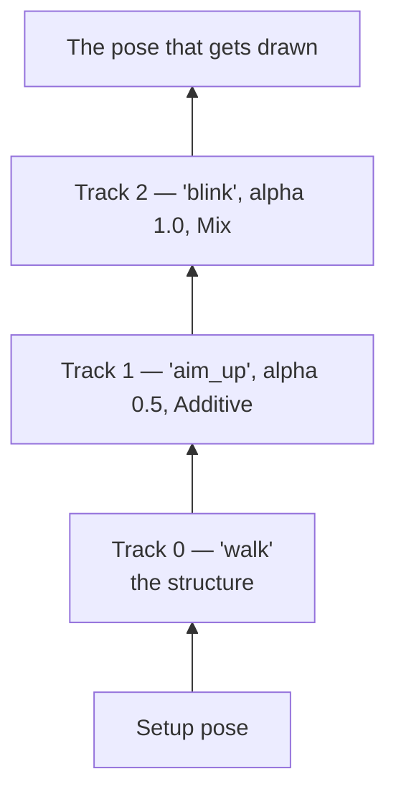

# Motion blending

Play several animations on one character at once, and move between them without a cut. A walk
underneath, an aim overlay on top, a one-shot reaction crossfading in — from files an animator
authored separately.

!!! info "On every face"
    The examples here are `SSPlayer`'s Rust API. The C face has the same calls as `ss_player_*`,
    the JavaScript face as camelCase methods on `SsPlayerWeb`, and the Bevy adapter as the
    `SsTrackCommand` message, with the stack read back from `SsTrackState` — except track 0's
    animation, which Bevy changes through `SsPlayer::animation` alone, crossfading when
    `SsPlayer::transition_ms` is set. See the
    [C](../reference/c.md#motion-blending), [JavaScript](../reference/js.md#motion-blending) and
    [Bevy](../reference/bevy.md#motion-blending) references.

## The model: a stack of tracks

Tracks fold onto the **setup pose** in ascending order. Each track has an animation, an **alpha**
(how much of it survives onto the pose below) and a **blend mode**.



**Track 0 is special.** It is what `set_animation` establishes, and it carries the structure — the
instance tree is built from it. Its animation is the one the player reports: `current_animation`,
`is_finished`, the frame read-outs, the events and the canvas all follow it. The tracks above it are
overlays.

| Blend mode | What it does |
|---|---|
| `TrackBlend::Mix` | Lerps toward the track's pose. At alpha 1 the track wins outright |
| `TrackBlend::Additive` | Adds the track's **offset from the setup pose**, so what is underneath still shows through — the mode for an aim, a lean, a breath |

## Laying an overlay on

```rust
use ssplayer_wgpu::TrackBlend;

player.set_animation("walk")?;          // track 0 — rebuilds the instance tree
player.play();

player.set_track_animation(1, "aim_up")?;      // an overlay
player.set_track_blend(1, TrackBlend::Additive)?;
player.set_track_alpha(1, 0.5)?;               // half strength

// ... and take it off again
player.clear_track(1)?;
```

`clear_track` refuses track 0 — fade it to alpha 0 instead, which settles the character onto the
setup pose.

!!! warning "Setting track 0 rebuilds the stack"
    `set_animation` establishes track 0 *and the instance tree*, so any overlay you had laid on
    goes with it. Re-apply overlays after switching the base animation.

## Fading, rather than cutting

Both fades are advanced by the scene's `update` — you start one and keep drawing.

```rust
// Swap what a track is playing, over 400 ms, starting from wherever it is now.
player.crossfade(0, "run", 400.0)?;

// Drive a track's alpha somewhere, over 250 ms.
player.fade_track(1, 0.0, 250.0)?;    // fade the overlay out
player.fade_track(0, 0.0, 600.0)?;    // settle the whole character onto the setup pose

if let Some(t) = player.track_fade_progress(0) { /* 0..1 */ }
player.cancel_track_fade(1)?;
```

### What a crossfade on track 0 changes, and when

The incoming animation takes track 0 over **when the fade begins**, not when it ends:

* `current_animation()` names it straight after the call, so `set_animation` with the name the fade
  left behind switches back rather than doing nothing. The canvas follows it too.
* Its cell, visibility and other values that cannot be blended show from the first frame of the
  fade. Its playback state is what `is_finished` and `just_finished` report: the outgoing animation
  running out during the fade does not finish the player.
* Its events fire from the start; the outgoing animation's fall silent (see the events note below).
* It plays with the transport you set — speed, frame rate, frame skip, direction and loop count —
  as if `set_animation` had switched to it. The section is its own whole length.

Everything the track was playing fades out together, keeping its proportions. A second `crossfade`
during a fade takes the fade in flight over as it stands, so the pose does not jump; nor does a
`crossfade` after `cancel_track_fade`, or from a track mixing several animations.

!!! note "Crossfading track 0 does not rebuild the instance tree"
    That is what makes it a *fade* rather than a switch. The instance and effect parts belong to
    the pack, not to one animation, so every animation of it has the same tree and the running
    children carry on. Which key drives a child from the handover on is the incoming animation's,
    and a child is restarted only where that key differs from the one it was playing: instance and
    effect children are outside motion blending (see the limits below).

## Mixing two animations on one track

A track can carry more than one animation, mixed by **weight** — the way a walk and a run blend by
how fast the character moves. Each one is a *source*, named by a handle:

```rust
player.set_animation("walk")?;
player.play();
let walk = player.track_main_source(0).unwrap();
let run = player.add_track_source(0, "run", 0.0)?;   // beside the walk, silent for now

// every frame, from the character's speed
player.set_source_weight(walk, 1.0 - t)?;
player.set_source_weight(run, t)?;
```

* Weights are **ratios within the track**: `(0.7, 0.3)` and `(7, 3)` mix alike. The track's
  strength is still its alpha.
* A walk and a run of different lengths drift apart. Lay the run with the track's sync at
  `TrackSync::Start` (below) to start it in step, or seek it with `set_source_frame`.
* Only track 0's main source fires events. To have another source fire, lower its threshold to its
  weight or below with `set_source_event_threshold`. The outgoing side of a crossfade has its own,
  per track: `set_track_outgoing_event_threshold(track, 0.5)` keeps it firing through the first half
  of the fade (the default, infinity, silences it from the start).
* A handle stays valid until its source is released: a crossfade completing, `clear_track`, or
  `set_animation`.

## Starting in step with track 0

An animation laid on a track starts from the head of its section. Lay a run over a walk that is
half-way through its stride and the feet disagree. Set the track's **sync** to `TrackSync::Start`
and what is laid on it next starts at the **phase** track 0 stands at — how far through its
section it is, from 0.0 at the start towards 1.0 at the end — so animations of different lengths
line up by proportion:

```rust
use ssplayer_wgpu::TrackSync;

player.set_track_sync(0, TrackSync::Start)?;   // set it before laying
player.crossfade(0, "run", 400.0)?;            // run starts at the walk's phase
```

| Sync | Where a laid animation starts | Suited to |
|---|---|---|
| `TrackSync::Free` (default) | The head of its section | One-off motions: a blink, a mouth shape, a hit reaction |
| `TrackSync::Start` | The same fraction of its section as track 0's animation | Cyclic motions over one another: walk and run |

* It applies to everything laid on the track afterwards — `set_track_animation`, `crossfade` and
  `add_track_source`, track 0 included, where the incoming animation starts at the outgoing one's
  phase.
* It aligns **once**, when the animation is laid. Both then run on one clock, so animations of
  the same length and speed stay in step; different lengths or speeds drift apart again.
* It belongs to the track, like its alpha and blend: `set_animation` resets every track to
  `Free`, so set it again after switching the base animation.

## A track's playback settings

The speed, the frame-rate override, frame skip and the direction belong to the **track**, not to the
animation on it: they reach every animation on the track, both sides of a crossfade included, and
every one laid on it later.

```rust
use ssplayer_wgpu::{PlaybackDirection, PlaybackStyle};

player.set_track_speed(1, 0.5)?;
player.set_track_frame_rate(1, 24)?;
player.set_track_frame_skip_enabled(1, false)?;
player.set_track_playback_direction(1, PlaybackDirection::Forward, PlaybackStyle::PingPong)?;
```

Track 0's are the transport calls: `set_speed_scale` is track 0's `set_track_speed`, and so on. The
**loop count** is the animation's, not the track's — laying an animation starts it looping forever —
so state it after laying, and watch the track end:

```rust
player.set_track_animation(2, "hit_react")?;
player.set_track_loop_count(2, 1)?;            // once, then hold the last frame

// each frame
if player.is_track_finished(2) {
    player.fade_track(2, 0.0, 120.0)?;         // a finished track holds its last frame until you act
}
```

`track_just_looped(track)` is the per-update pulse, as `just_looped` is for track 0. Neither track
above 0 finishing nor looping is an edge the player raises for you; only track 0's end is
`just_finished`.

## Scrubbing a track: continuous control

Author a control axis as an animation — a head turning from full left to full right, an eyelid
opening — then do not *play* it. **Scrub it** with whatever value you are tracking:

```rust
player.set_track_animation(1, "look_lr")?;
player.set_track_blend(1, TrackBlend::Additive)?;
player.set_track_speed(1, 0.0)?;             // it does not advance on its own
player.set_track_frame(1, head_yaw_frame)?;  // ... you drive it
```

That is how a face follows a camera or a mouse without any of the blending being authored per
frame: the animator authors the extremes, the application picks the point between them.

## A worked shape

A common three-track arrangement for a character in a game:

| Track | Animation | Blend | Driven by |
|---|---|---|---|
| 0 | `idle` / `walk` / `run` | — | `crossfade(0, …, 200.0)` on a state change |
| 1 | `aim_lr` | Additive, speed 0 | `set_track_frame` from the aim angle |
| 2 | `hit_react` | Mix | `set_track_animation` + `set_track_loop_count(2, 1)`, faded back out once `is_track_finished(2)` |

Query what is up there with `track_count()`, `track_alpha(track)`, `track_blend(track)`,
`track_sync(track)`, `track_frame(track)`, `track_speed(track)`, `track_loop_count(track)` and the
other `track_*` reads.

## Two limits

* **Instance children are not layered.** A part that plays another pack's animation runs its own
  playback context, driven by its slot on the root's frame. Tracks apply to the character whose
  `SSPlayer` you are holding. The same goes for effect parts, and for which key drives either kind
  of child across a crossfade on track 0.
* A track's **alpha** is its strength. Where several animations share one track, a source's
  *weight* only sets proportions among them — it is not a second volume control.

## See it

`cargo run -p ssplayer-wgpu-viewer` drives all of this from the keyboard, because the eye is the
only judge of some of it — whether a crossfade reads as a blend or a cut, whether an additive
overlay leaves the performance underneath showing:

| Key | |
|---|---|
| `C` | crossfade track 0 to the next animation (400 ms) |
| `S` | cycle which animation sits on track 1, or take it off |
| `1` / `2` | track 1 alpha down / up |
| `A` | track 1 mix / additive |
| `0` | fade track 0 to the setup pose and back |
| `,` / `.` | scrub track 1's frame — the tracking-driven axis above |
| `Y` | track sync free / start, for the whole cast — compare `C` and `S` both ways |
| `3` | track 0 speed 1× / 2× / 0.5× — a crossfade keeps it |
| `T` | track 0 loops once / forever — the animation a crossfade hands over ends, the one it left does not |
| `4` | track 1 loops once / forever — a finished overlay holds its last frame |
| `E` | the outgoing side of a track 0 crossfade fires events: never / through the first half |

The status block names track 0's current animation, which changes the moment you press `C`, and
lists the last events with the source that fired them. `cargo run -p ssplayer-bevy-viewer` has the
same keys.

## Next

* [Playback and transport](./playback.md) — the transport that drives track 0
* [Performance](./performance.md) — what a second and third track cost
