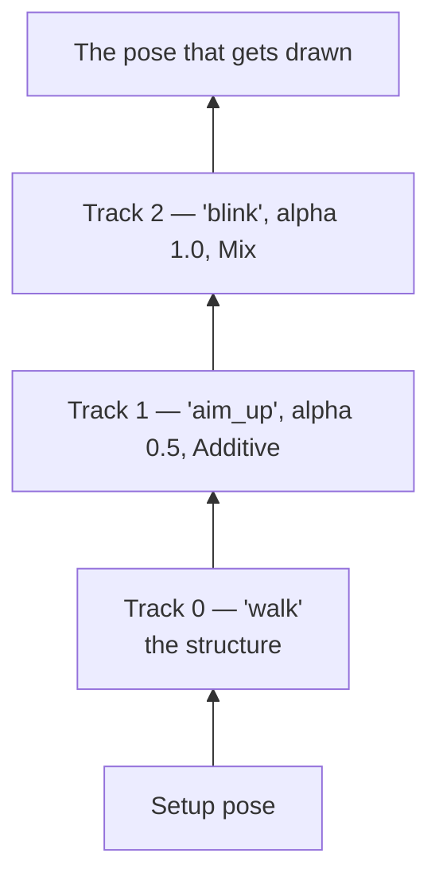

# Motion blending

Play several animations on one character at once, and move between them without a cut. A walk
underneath, an aim overlay on top, a one-shot reaction crossfading in — from files an animator
authored separately.

!!! info "On every face"
    The examples here are `SSPlayer`'s Rust API. The C face has the same calls as `ss_player_*`,
    the JavaScript face as camelCase methods on `SsPlayerWeb`, and the Bevy adapter as the
    `SsTrackCommand` message, with the stack read back from `SsTrackState`. See the
    [C](../reference/c.md#motion-blending), [JavaScript](../reference/js.md#motion-blending) and
    [Bevy](../reference/bevy.md#motion-blending) references.

## The model: a stack of tracks

Tracks fold onto the **setup pose** in ascending order. Each track has an animation, an **alpha**
(how much of it survives onto the pose below) and a **blend mode**.



**Track 0 is special.** It is what `set_animation` establishes, and it carries the structure — the
instance tree is built from it. The tracks above it are overlays.

| Blend mode | What it does |
|---|---|
| `TrackBlend::Mix` | Lerps toward the track's pose. At alpha 1 the track wins outright |
| `TrackBlend::Additive` | Adds the track's **offset from the setup pose**, so what is underneath still shows through — the mode for an aim, a lean, a breath |

## Laying an overlay on

```rust
use ssplayer_wgpu::TrackBlend;

player.set_animation("walk")?;          // track 0 — rebuilds the instance tree
player.play();

player.set_track_animation(1, "aim_up")?;      // an overlay
player.set_track_blend(1, TrackBlend::Additive)?;
player.set_track_alpha(1, 0.5)?;               // half strength

// ... and take it off again
player.clear_track(1)?;
```

`clear_track` refuses track 0 — fade it to alpha 0 instead, which settles the character onto the
setup pose.

!!! warning "Setting track 0 rebuilds the stack"
    `set_animation` establishes track 0 *and the instance tree*, so any overlay you had laid on
    goes with it. Re-apply overlays after switching the base animation.

## Fading, rather than cutting

Both fades are advanced by the scene's `update` — you start one and keep drawing.

```rust
// Swap what a track is playing, over 400 ms, starting from wherever it is now.
player.crossfade(0, "run", 400.0)?;

// Drive a track's alpha somewhere, over 250 ms.
player.fade_track(1, 0.0, 250.0)?;    // fade the overlay out
player.fade_track(0, 0.0, 600.0)?;    // settle the whole character onto the setup pose

if let Some(t) = player.track_fade_progress(0) { /* 0..1 */ }
player.cancel_track_fade(1)?;
```

!!! note "Crossfading track 0 does not rebuild the instance tree"
    That is what makes it a *fade* rather than a switch: the tree stays as the current animation
    built it. So crossfading to an animation whose **instance parts differ** is out of scope — use
    `set_animation` for that, and accept the cut.

## Mixing two animations on one track

A track can carry more than one animation, mixed by **weight** — the way a walk and a run blend by
how fast the character moves. Each one is a *source*, named by a handle:

```rust
player.set_animation("walk")?;
player.play();
let walk = player.track_main_source(0).unwrap();
let run = player.add_track_source(0, "run", 0.0)?;   // beside the walk, silent for now

// every frame, from the character's speed
player.set_source_weight(walk, 1.0 - t)?;
player.set_source_weight(run, t)?;
```

* Weights are **ratios within the track**: `(0.7, 0.3)` and `(7, 3)` mix alike. The track's
  strength is still its alpha.
* A walk and a run of different lengths drift apart. Lay the run with the track's sync at
  `TrackSync::Start` (below) to start it in step, or seek it with `set_source_frame`.
* Only track 0's main source fires events. To have another source fire, lower its threshold to its
  weight or below with `set_source_event_threshold`.
* A handle stays valid until its source is released: a crossfade completing, `clear_track`, or
  `set_animation`.

## Starting in step with track 0

An animation laid on a track starts from the head of its section. Lay a run over a walk that is
half-way through its stride and the feet disagree. Set the track's **sync** to `TrackSync::Start`
and what is laid on it next starts at the **phase** track 0 stands at — how far through its
section it is, from 0.0 at the start towards 1.0 at the end — so animations of different lengths
line up by proportion:

```rust
use ssplayer_wgpu::TrackSync;

player.set_track_sync(0, TrackSync::Start)?;   // set it before laying
player.crossfade(0, "run", 400.0)?;            // run starts at the walk's phase
```

| Sync | Where a laid animation starts | Suited to |
|---|---|---|
| `TrackSync::Free` (default) | The head of its section | One-off motions: a blink, a mouth shape, a hit reaction |
| `TrackSync::Start` | The same fraction of its section as track 0's animation | Cyclic motions over one another: walk and run |

* It applies to everything laid on the track afterwards — `set_track_animation`, `crossfade` and
  `add_track_source`, track 0 included, where the incoming animation starts at the outgoing one's
  phase.
* It aligns **once**, when the animation is laid. Both then run on one clock, so animations of
  the same length and speed stay in step; different lengths or speeds drift apart again.
* It belongs to the track, like its alpha and blend: `set_animation` resets every track to
  `Free`, so set it again after switching the base animation.

## Scrubbing a track: continuous control

Author a control axis as an animation — a head turning from full left to full right, an eyelid
opening — then do not *play* it. **Scrub it** with whatever value you are tracking:

```rust
player.set_track_animation(1, "look_lr")?;
player.set_track_blend(1, TrackBlend::Additive)?;
player.set_track_speed(1, 0.0)?;             // it does not advance on its own
player.set_track_frame(1, head_yaw_frame)?;  // ... you drive it
```

That is how a face follows a camera or a mouse without any of the blending being authored per
frame: the animator authors the extremes, the application picks the point between them.

## A worked shape

A common three-track arrangement for a character in a game:

| Track | Animation | Blend | Driven by |
|---|---|---|---|
| 0 | `idle` / `walk` / `run` | — | `crossfade(0, …, 200.0)` on a state change |
| 1 | `aim_lr` | Additive, speed 0 | `set_track_frame` from the aim angle |
| 2 | `hit_react` | Mix | `set_track_animation` + `fade_track(2, 1.0, 80.0)`, faded back out on completion |

Query what is up there with `track_count()`, `track_alpha(track)`, `track_blend(track)`,
`track_sync(track)` and `track_frame(track)`.

## Two limits

* **Instance children are not layered.** A part that plays another pack's animation runs its own
  playback context, driven by its slot on the root's frame. Tracks apply to the character whose
  `SSPlayer` you are holding.
* A track's **alpha** is its strength. Where several animations share one track, a source's
  *weight* only sets proportions among them — it is not a second volume control.

## See it

`cargo run -p ssplayer-wgpu-viewer` drives all of this from the keyboard, because the eye is the
only judge of some of it — whether a crossfade reads as a blend or a cut, whether an additive
overlay leaves the performance underneath showing:

| Key | |
|---|---|
| `C` | crossfade track 0 to the next animation (400 ms) |
| `S` | cycle which animation sits on track 1, or take it off |
| `1` / `2` | track 1 alpha down / up |
| `A` | track 1 mix / additive |
| `0` | fade track 0 to the setup pose and back |
| `,` / `.` | scrub track 1's frame — the tracking-driven axis above |
| `Y` | track sync free / start, for the whole cast — compare `C` and `S` both ways |

## Next

* [Playback and transport](./playback.md) — the transport that drives track 0
* [Performance](./performance.md) — what a second and third track cost
