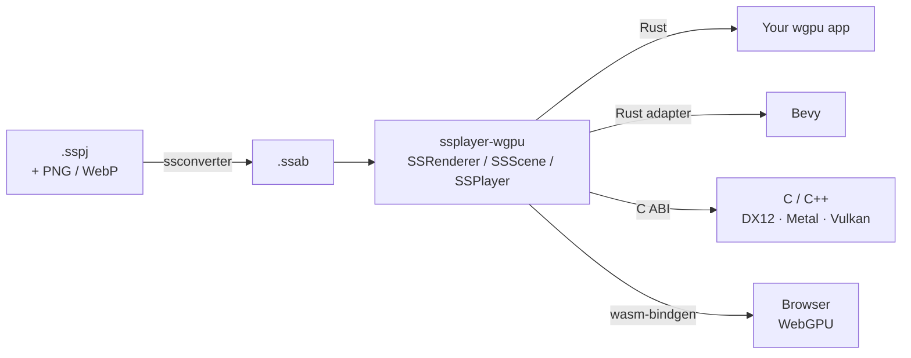

# 🦀 SpriteStudio Player for wgpu

Play **[SpriteStudio](https://www.webtech.co.jp/spritestudio/)** animations (`.ssab`)
through [wgpu](https://wgpu.rs/) — one renderer, one set of shaders, and four ways to call it.
Your artist rigs the motion in a dedicated editor; you load the file and press play. No video
files, no re-authoring, no engine lock-in.

wgpu puts **WebGPU, Vulkan, DirectX 12 and Metal** behind a single API, which is why a browser
canvas, a Windows game and a macOS app can all be served by the same library instead of by four
ports of it.

!!! tip "Try it in your browser"
    <a href="./demo/" target="_blank" rel="noreferrer">▶️ Open the WebGPU demo</a>, published beside
    these pages. Nothing to install; it needs a WebGPU-capable browser. Four pages: the API in both its
    shapes, the <a href="./demo/element.html" target="_blank" rel="noreferrer">custom element</a> on
    its own, <a href="./demo/multi.html" target="_blank" rel="noreferrer">a page full of them</a> —
    overlapping other content, on one `GPUDevice` — and
    <a href="./demo/part-follow.html" target="_blank" rel="noreferrer">a marker following a part</a>,
    its pose read back by the host every frame. Drop a folder of your own `.ssab` on the first one and
    it plays them, atlases and sibling packs included.

!!! tip "No SpriteStudio data of your own yet?"
    The [official sample data](https://www.webtech.co.jp/help/ja/spritestudio7/download/sample/) works as-is — that page is
    Japanese only, but the downloads themselves are language-neutral.
    [Ringo](https://www.webtech.co.jp/help/ja/spritestudio7/download/sample/#ringo) is a good character sample, and
    [Particle](https://www.webtech.co.jp/help/ja/spritestudio7/download/sample/#Perticle_sample) is a good one if you want effects.

## 🚀 Start here

Four ways to call one library. Pick the one your app is written in — each path is complete on its
own, and you never need the other three.

-   :material-language-rust: __Rust__

    ---

    You own a `wgpu::Device` and a render pass — your own renderer, `winit`, `egui`, `Slint`.
    The player draws into the pass you opened.

    :octicons-arrow-right-24: [Get started with Rust](./start/rust.md)

-   :material-gamepad-variant: __Bevy__

    ---

    Add a plugin, spawn three components. Characters go into Bevy's own 2D pass, on the device
    Bevy already owns. You never touch wgpu.

    :octicons-arrow-right-24: [Get started with Bevy](./start/bevy.md)

-   :material-language-cpp: __C / C++__

    ---

    A static library and one header. Hand it your `HWND`, `CAMetalLayer`, `Window` or
    `wl_surface` and call two functions per frame — DX12, Metal or Vulkan underneath.
    **No wgpu type ever crosses the ABI.**

    :octicons-arrow-right-24: [Get started with C / C++](./start/cpp.md)

-   :material-web: __JavaScript / TypeScript__

    ---

    An npm package with the WebGPU renderer compiled to WebAssembly, plus a
    `<ss-player-webgpu>` element for the one-character case. The device is built for you.

    :octicons-arrow-right-24: [Get started on the web](./start/web.md)

Whichever you pick, you also need a `.ssab` — see [Preparing assets](./start/assets.md). Nothing of
your own is required to try the player first: every sample runs on the SDK's own test animations.

## 🧭 How these docs are laid out

| Section | Who reads it |
|---|---|
| **[Get started](./start/rust.md)** | Everyone, **once**. Four short paths, one per environment; each is complete on its own — install, load, play, frame loop. This is the only place you choose. |
| **[Guide](./guide/concepts.md)** | Everyone, from then on. One text with the code in per-language tabs: pick your language on any page and the whole site follows. |
| **[API reference](./reference/rust.md)** | When you need the exact name of something. One page per face. |
| **[wgpu hosts](./wgpu/borrow-model.md)** | Only if you own the device — a Rust application or an engine adapter. A C++ or browser reader never needs this section. |
| **[For Player & SDK Developers](./development/build.md)** | Building every face of the library yourself, using a changed Player in a host, and how the player is put together. |

Two more things are published beside this text rather than inside it: the
<a href="./api/" target="_blank" rel="noreferrer">Rust API reference</a> (rustdoc for
`ssplayer_wgpu` and `ssplayer_bevy`) and the
<a href="./demo/" target="_blank" rel="noreferrer">WebGPU demo</a>. Both are in the navigation as
well: the rustdoc under API reference, the demo under Get started.

## 📦 What ships

One library, four packages. The Rust crates are on crates.io, the C library
is a zip on each
[`ssplayer-wgpu` Release](https://github.com/cri-middleware/SSPlayerForWgpu/releases?q=ssplayer-wgpu&expanded=true),
and the web package is on npm.

| Face | Ships as |
|---|---|
| Rust | the `ssplayer-wgpu` crate on crates.io |
| Bevy | the `ssplayer-bevy` crate on crates.io |
| C / C++ | `ssplayer-wgpu-windows-x86_64.zip` and `ssplayer-wgpu-macos-universal.zip` — `include/`, `lib/`, `README.md`, `docs/` (these pages, in English), `LICENSE.md`, `LICENSE.ja.md`, `THIRD_PARTY_NOTICES.md` |
| Web | `@spritestudio/ssplayer-wgpu` on npm |

## 🗺️ From editor to screen

Conversion happens **ahead of time**: this player converts nothing at runtime and bundles no
converter. See [Preparing assets](./start/assets.md).

## 🔗 Related

- [SpriteStudio Docs](https://cri-middleware.github.io/SpriteStudio-Docs/) — the portal for the SDK
  and every official player.
- [SpriteStudio-SDK](https://github.com/cri-middleware/SpriteStudio-SDK) — `ssruntime` and `ssab`,
  the shared core this player links directly.
- [SpriteStudio Player for Web](https://github.com/cri-middleware/SSPlayerForWeb) — the WebGL player,
  the answer where WebGPU is missing.
- [SSConverterGUI](https://github.com/cri-middleware/SSConverterGUI) — desktop converter.
