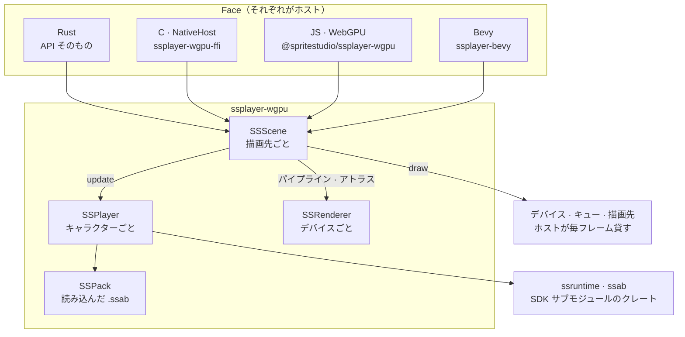

# プレイヤーの構成

SpriteStudio Player for wgpu を開発する人と、自分のホストのために改造する人に向けたページです。部品をその役割で説明します。チェックアウトのビルドと検証、変更したプレイヤーをホストで使う方法、実際のホストでの確かめ方は[ビルドガイド](build.md)に、制約は [`CONTRIBUTING.md`](https://github.com/cri-middleware/SSPlayerForWgpu/blob/main/CONTRIBUTING.md) にあります。

SpriteStudio の Player に共通すること（再生・モーションブレンド・サウンドキー・パーツトラッキングの振る舞い）は、SDK の [Player 移植ガイド](https://github.com/cri-middleware/SpriteStudio-SDK/tree/HEAD/libs/ssruntime/docs) に一度だけ書いてあります。

## 層

ランタイムは SDK の `ssruntime` クレートで、`.ssab` のスキーマの `ssab` と一緒に、`SpriteStudio-SDK` サブモジュールへの path 依存でリンクします。ランタイムはタイムラインを進め、各フレームを描画計画と平らなバッファとして返します。`ssplayer-wgpu` クレートはその計画を、ホストが持つデバイスの上で wgpu で描きます。矢印は呼び出しです。

### リソースの寿命で分けた 3 つの型

| 型 | 1 つあたり | 持つもの |
|---|---|---|
| `SSRenderer` | デバイス | パイプライン、バインドグループレイアウト、サンプラー、シェーダーモジュール、アトラスのテクスチャ |
| `SSScene` | 描画先 | 投影とフレームのジオメトリ。その描画先に描くすべてのプレイヤーが追記する `FrameChunk`（アリーナ・プリミティブ・描画呼び出し）を 1 つ持つ |
| `SSPlayer` | キャラクター | 再生のツリー。アニメのインスタンスごとにランタイムの `Context` を 1 つ持つ。GPU のリソースは持たない |

デバイス・キュー・レンダラー・描画先は、ホストが毎フレーム貸します。3 つの型のどれも、それらを持ちません。

その横で、`SSPack` は読み込んだ `.ssab` 1 つを何体のプレイヤーでも共有するもので、CPU のデータだけを持ちます。`SSPlayer::load` はそれをファイルシステムから読み、アトラスを短命のスレッドに分けてデコードします。クレートはほかに、タイムラインのイベントを所有する値にデコードし、どのパーツがマスクのカバレッジをどう書くかを決め（`ssplayer-webgl` のマスクのプランナーの移植）、ホストが割り付けた箱にアニメを収め（`fit` / `align`）、フレームのコストを報告し（`SceneStats`。回数と、タイムスタンプクエリがあれば GPU のパスの時間）、1 フレーム分のランタイムのバッファを借りて見せ（`FrameView`）、ホストが渡すハンドルのための世代付きのスロットを持ちます。

### Face

| Face | 内容 |
|---|---|
| Rust | API。ホストが動かす 3 つの型 |
| C | `NativeHost` が生のウィンドウハンドルから wgpu のスタックを作って持ち、C の入口は C ABI をそれに翻訳するだけ。`ssplayer-wgpu-ffi` クレートがライブラリをビルドし、`ssplayer_wgpu.h` を再生成する |
| JS | `requestAnimationFrame` で動く WebGPU の wasm-bindgen のホストと、`@spritestudio/ssplayer-wgpu` パッケージにあるその上の TypeScript の層 |
| C と JS の両方 | 自分の面を持つ 2 つの Face が同じように設定・リサイズ・描画するスワップチェーン |
| Bevy | `ssplayer-bevy` クレート。Bevy の main world のコンポーネントと、render world の再生ツリー・`SSRenderer` 1 つ・`SSScene` 1 つ |

`examples/` には Face ごとのホストがあります。`hello`（いちばん小さい Rust のホスト）、`viewer` と Bevy のビューア、Metal・DX12・Vulkan の C++ ビューア、`web` です。

`ssplayer-bevy` は、`CONTRIBUTING.md` が歩調を揃えるよう求める 3 つの Face（Rust・C・JS）の横にあるアダプタのクレートで、Rust の API を通して描きます。

## この作りになっている理由

ここに挙げる理由はどれも複数のファイルにまたがります。詳細は、関わるコードのコメントにあります。

**プレイヤーは借り、ホストが持ちます。** ゲームエンジンは自分のデバイス・キュー・フレームをすでに持っているので、プレイヤーはその 3 つを借ります。1 つのクレートで素のビューア・ブラウザの canvas・Bevy のどれにも描けるのはこのためで、型（`SSRenderer`・`SSScene`・`SSPlayer`）をリソースの寿命（デバイスで有効なもの、描画先 1 つで有効なもの、キャラクター 1 体のもの）で分けているのもこのためです。

**パックは GPU のテクスチャを持ちません。** テクスチャはホストのアセットの寿命に属します（Bevy なら `Assets<Image>` と render world の `GpuImage`）。そのため `SSPack` は必要なテクスチャを記述して画素を渡し、GPU のメモリを持つ側がそれをレンダラーに登録します。レンダラーのテクスチャマップはデバイススコープなので、同じデバイス上の 2 つのシーンは同じパックを 1 回のアトラスアップロードから描きます。これは `libs/ssplayer-wgpu/tests/pack.rs::scenes_share_one_renderer` が固定しています。

**CPU は頂点の座標変換をしません。** 描く各パーツについて、ランタイムの平らな配列のその部分をフレームのアリーナにコピーし、ジオメトリの位置を示すプリミティブのレコードをパーツごとに 1 つ書きます。頂点ステージは両方を読みます。このレコードの配置は、Rust と WGSL で歩調をそろえる必要があります。CPU に頂点ごとの仕事は無く、作り直す頂点バッファもありません。

**C の Face は翻訳だけをします。** C のどの入口も、引数を検証し、変換し、`NativeHost` か `SSPlayer` を呼ぶだけです。振る舞いはその 2 つの裏にあり、Rust の API も同じものを使います。C の Face と各 web の canvas が共有するスワップチェーンの手順を 1 か所に置いているのも同じ理由で、2 つの写しの片方にだけ修正が届くことを防ぎます。

**マスクの backend は 2 つあります。** ホストのステンシル（`MaskBackend::Stencil`）はすべてのパスにステンシルのアタッチメントを要します。プレイヤーが自分でラスタライズするカバレッジのビットマップ（`MaskBackend::Coverage`）はそれを要さず、Bevy の 2D パスのように持たないホストはこちらを使います。どちらも、プレイヤーのインスタンスツリー全体で書き手は 96 までで、Godot の Player と同じなので、`.ssab` はどちらでも同じに描かれます。マスクの機能は両方に入れます。

**ローダーは読んでから base を張ります。** `load` の裏の走査は、渡された `src` をそのまま `AssetLoader::read` に渡し、その後で初めて `set_base(src)` を呼びます。`src` はそれ由来の base が存在するより前に読まれるので、「`src` を `src` 自身に対して解決する」という状態は表現できません。この順序が安全性の要で、`libs/ssplayer-wgpu/tests/loader_contract.rs` が守っています。

**描画のコードは WebGL 版から来ていて、規則は Player 移植ガイドから来ます。** ブレンドの表、PartsColor のプログラム、統合シェーダー、マスクのプランナーは `ssplayer-webgl` から移植したもので、そう書いたコメントが移植元を名指しています。`.ssab` がどう描かれるべきかを決めるのは Player 移植ガイドで、ガイドに書いていないところはこの Player です。ほかの Player はこの Player を基準に読まれます（SpriteStudio-SDK の `MAINTAINING_PLAYERS.md` §5）。描き方の変更はガイドに照らして確かめ、それで決まった規則は同じ変更でガイドに書き足します。
