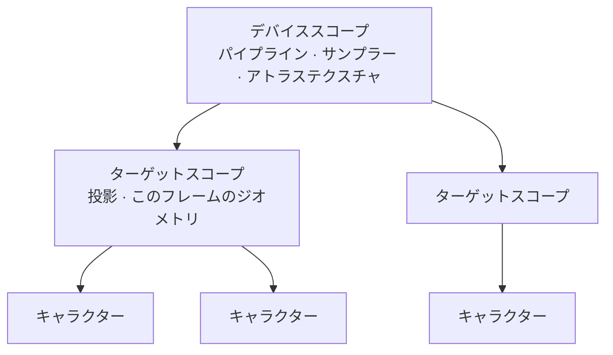

# スコープと名前の対応

ここから先は、4 つの Face に対して本文が 1 つです。語彙は違いますが、モデルは同じ。このページがその橋渡しで、一度読めば以降のガイドは自分の言語で読めます。

!!! tip "言語は 1 度だけ選べば済みます"
    以下のコードはタブになっています。選んだタブはこのサイトの**全ページ**で記憶されるので、2 度選ぶ必要はありません。

## 3 つのスコープ

Player は状態を、オブジェクトの階層ではなく「**保持しているものがどれだけの期間有効か**」で分けています。



| スコープ | 保持するもの | いくつ持つか |
|---|---|---|
| **デバイス** | パイプライン、バインドグループレイアウト、サンプラー、アトラステクスチャ | GPU デバイスごとに 1 つ。ウィンドウごとではありません |
| **ターゲット** | 投影行列、フレームのジオメトリアリーナ、ドローリスト | 描き込む先ごとに 1 つ（ウィンドウ、キャンバス、オフスクリーンテクスチャ） |
| **キャラクター** | 再生ツリー、トランスフォーム、描画順、表示、アルファ | 画面上のキャラクター 1 体ごとに 1 つ |

実務上効いてくる帰結は 1 つ：**キャラクターは GPU リソースを一切持ちません。** 同じターゲットの 10 体はアトラスアップロード 1 回・パイプライン 1 セット・レンダーパス 1 回を共有します。2 体目が足すのは再生ツリーと自分のパーツ分だけで、パスもパイプラインもアトラスのアップロードも増えません。

## Face ごとの名前

| スコープ | Rust | C | JavaScript | Bevy |
|---|---|---|---|---|
| デバイス | `SSRenderer` | *(`ss_scene_t` に内包)* | `SsContextWeb` | *(プラグイン内部)* |
| ターゲット | `SSScene` | `ss_scene_t` | `SsSurfaceWeb` | *(カメラのビュー)* |
| キャラクター | `SSPlayer` | `ss_player_t` | `SsPlayerWeb` | `SsPlayer` を持つエンティティ |

非対称なところが 2 つあり、これが「何が安いか」を変えます：

* **C はデバイススコープとターゲットスコープを `ss_scene_t` に融合しています。** このハンドルは指定したウィンドウ上に構築されたグラフィックススタック一式なので、**1 ウィンドウ＝1 デバイス**です。1 つの C++
  アプリで 2 ウィンドウなら 2 デバイスになります。一方、**1 ウィンドウに 2 キャラクター**なら 1 デバイスで、
  `ss_scene_t` と `ss_player_t` を分けているのはそのためです。
* **JavaScript は両者を分けたまま**なので、`<ss-player-webgpu>` が 8 個あるページでも `GPUDevice` はちょうど 1 つです。`SsContextWeb` がページ、`SsSurfaceWeb` がキャンバスです。

## フレーム処理

形はどの言語でも同じ：**全部進めて、全部を 1 回で描く。**

=== "Rust"

    ```rust
    scene.update(&mut renderer, &device, &queue, delta_secs, &mut [&mut a, &mut b]);
    scene.encode_offscreen(&mut renderer, &device, &mut encoder); // カバレッジマスクと group alpha のレイヤー
    let mut rpass = encoder.begin_render_pass(&descriptor);
    scene.draw(&renderer, &mut rpass);
    ```

=== "C"

    ```c
    ss_scene_update(scene, delta_seconds);   /* このシーンの全プレイヤー */
    ss_scene_render(scene);                  /* 1 パス、そして present */
    ```

=== "JavaScript"

    ```js
    surface.frame(dt);   // このキャンバスの全プレイヤーを更新し 1 パスで描画
    ```

=== "Bevy"

    ```rust
    // 何も書きません。プラグインのシステムが Bevy の Core2d MainPass 内、
    // main_transparent_pass_2d の後で毎フレーム動きます。
    ```

**そのターゲットの全キャラクターを 1 回の update に通してください。** 同じターゲットへの 2 回目の `update` は新しいフレームを始め、1 回目が作ったものを置き換えるので、描かれるのは最後の呼び出しのキャラクターだけです。同じキャラクターを 2 つのターゲットの update に渡すと、1 フレームで 2 回進みます。

ターゲット内の前後関係は `set_order` の昇順です。ツリーではなく単なる整数です。

## Face ごとにできること { #what-each-face-can-do }

ライブラリは 1 つですが、Face が公開している範囲は異なります。— は予定の約束ではありません。カバレッジの行は設計上の境界です。C と JavaScript の Face はレンダーパスとそのステンシルを自分で持ち、カバレッジはステンシルを貸せないパスのためにだけあります。計画は [ROADMAP](https://github.com/cri-middleware/SSPlayerForWgpu/blob/main/ROADMAP.md) を参照してください。

| | Rust | C | JavaScript | Bevy |
|---|:--:|:--:|:--:|:--:|
| [ロード（両エクスポートモード・兄弟パック）](./loading.md) | ✅ | ✅ | ✅ | ✅ |
| [再生制御：play / pause / resume / stop / seek](./playback.md) | ✅ | ✅ | ✅ | ✅ |
| [ループ回数・区間・再生方向・サブフレーム](./playback.md) | ✅ | ✅ | ✅ | ✅ |
| [イベント：ユーザーデータ・シグナル・オーディオ](./events.md) | ✅ | ✅ | ✅ | ✅ |
| [パーツオーバーライド：表示・セル・カラー](./part-overrides.md) | ✅ | ✅ | ✅ | — |
| [テクスチャ差し替え：セルマップ丸ごと](./texture-replacement.md) | ✅ | ✅ | ✅ | ✅ |
| [パーツのトランスフォーム取得](./part-overrides.md#reading-a-parts-transform) | ✅ | ✅ | ✅ | — |
| [group alpha：1 枚のレイヤーとしてフェード](./part-overrides.md#whole-character-tint-and-alpha) | ✅ | ✅ | ✅ | ✅ |
| [群衆描画：1 体を多数の配置に](./crowds.md) | ✅ | ✅ | ✅ | ✅ |
| [モーションブレンディング：トラック・クロスフェード・ソース](./motion-blending.md) | ✅ | ✅ | ✅ | ✅ |
| [マスク — ステンシル](./masks.md) | ✅ | ✅ | ✅ | — |
| [マスク — カバレッジビットマップ](./masks.md) | ✅ | — | — | ✅ |
| [テクスチャの自前供給](./loading.md#supplying-textures-yourself) | ✅ | ✅ | ✅ | — |
| [デバイスロストからの復帰](./device-loss.md) | ✅ | ✅ | ✅ | ✅ |
| [フレーム統計](./performance.md) | ✅ | ✅ | ✅ | — |
| 自分が持つレンダーパスへの描画 | ✅ | — | — | ✅ |

Bevy では再生ツリーがレンダーワールドにあるため、[モーションブレンディング](./motion-blending.md)は `SsTrackCommand` メッセージで操作し、結果を `SsTrackState` コンポーネントから読みます。

## 選択と再生開始は別の呼び出し

Rust・C・JavaScript では、**アニメーションを選ぶことと再生を始めることは別**です：

=== "Rust"

    ```rust
    player.set_animation("attack")?;  // インスタンスツリーを構築 — アロケーションを伴う
    player.play();                    // アロケーションの無い再生制御
    ```

=== "C"

    ```c
    ss_player_set_animation(player, "attack");
    ss_player_play(player);
    ```

=== "JavaScript"

    ```js
    player.setAnimation('attack');
    player.play();
    ```

=== "Bevy"

    ```rust
    // SsPlayer::animation を変えるとツリーが再構築され、SsPlayback::playing が true（既定）の間は
    // 先頭から再生されます。playing = false なら最初のフレームで保持します。
    ```

モーションの切り替えは頻繁に起きるので、頼んでいないアロケーションや、await の必要な Promise を伴わないように分かれています。各動詞の意味は[再生と再生制御](./playback.md)へ —
特に **`play()` で `pause()` を解除してはいけない**理由を。
