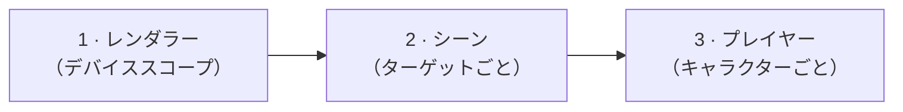

# デバイスロスト

GPU デバイスはアプリケーションの実行中に取り上げられることがあります（ドライバ更新、ノート PC の GPU 切替、ブラウザタブのバックグラウンド化、GPU プロセスのクラッシュ）。この Player はどの Face でも、`.ssab` を
1 つも読み直さずに復帰できます。

## 規則：外側へ向かって作り直す

復帰は新しいデバイス上で、**この順の**3 ステップです：



1. **`SSRenderer::restore_device`** — パイプライン、サンプラー、バインドグループレイアウト。
2. **`SSScene::restore_device`** — 投影 uniform とフレームバッファ（ターゲットごと）。
3. **`SSPlayer::restore_textures`** — 各キャラクターが自分のアトラスを登録し直します。

順序は必然です。キャラクターは自分のアトラスを*レンダラーに*登録するので、テクスチャを渡す前に新しいデバイス上のレンダラーが存在している必要があります。

再生状態（現在フレーム、ループ回数、再生制御）は CPU 側にあり、どこへも行っていません。巻き戻りません。

`SSRenderer::set_texture`（Rust）や `addTextureFromBitmap`（JavaScript）で登録したテクスチャの復帰はホストの仕事です。ピクセルは誰も保持していないので、レンダラーの復元後に登録し直してください。`Retention::Retain` の `upload_texture`、`addTexture`、`addTextureFromBytes`、`ss_scene_add_texture*`、`load` が取ってきたものは自動で戻り、埋め込みアトラスは手順 3 で `.ssab` から再びデコードされます。

## Face ごと

=== "Rust"

    ```rust
    // 失ったことは Device::set_device_lost_callback で分かります。
    // 新しいアダプタとデバイスを取り直し、この順に：
    renderer.restore_device(&device, &queue);
    scene.restore_device(&device, &queue);
    for player in &mut players {
        player.restore_textures(&mut renderer, &device, &queue);
    }
    ```

    自前で wgpu を組まず `NativeHost`（生のウィンドウハンドル）を使っている Rust ホストは、
    `NativeHost::restore_device()` がこの手順一式をラップしています。

=== "C"

    ```c
    if (ss_scene_is_device_lost(scene)) {
        if (ss_scene_restore_device(scene) != SS_OK) {
            fprintf(stderr, "%s\n", ss_last_error());
        }
    }
    ```

    デバイスロスト中、`ss_scene_update` と `ss_scene_render` は何もせず、`ss_scene_resize` はサイズを記録するだけです。したがって確認しないホストでも、クラッシュではなくウィンドウが固まるだけになります。

=== "JavaScript"

    ```js
    import { restoreSharedDevice } from '@spritestudio/ssplayer-wgpu';

    if (ctx.isDeviceLost()) {
      await restoreSharedDevice(ctx);   // ページ上の全キャンバス・全プレイヤー
    }
    ```

    フレームループで確認してください。各サーフェスとプレイヤーが保持済みのソースから再構築され、止まったところから再生が続きます。**`<ss-player-webgpu>` はこれを自前でやります。**

=== "Bevy"

    復帰は Bevy 自身の復帰に乗ります。新しいデバイスで Bevy が `RenderStartup` を再実行してレンダラーが作り直され、キャラクターは次のフレームにメインワールドから読み直されます。

    **opt-in が必要です。** Bevy の既定のエラーハンドラはデバイスロストで*終了*します。`DeviceLost` に `RenderErrorPolicy::Recover(RenderCreation::default())` を返す `RenderErrorHandler` を入れてください：

    ```rust
    use bevy::render::{
        error_handler::{ErrorType, RenderErrorHandler, RenderErrorPolicy},
        settings::RenderCreation,
    };

    app.insert_resource(RenderErrorHandler(|error, main_world, render_world| {
        if matches!(error.ty, ErrorType::DeviceLost) {
            RenderErrorPolicy::Recover(RenderCreation::default())
        } else {
            (RenderErrorHandler::default().0)(error, main_world, render_world) // Bevy の既定：ログを出して終了
        }
    }));
    ```

## 復帰できないもの

**カラーフォーマットの変更はデバイスロストではなく、その場では復帰できません。** シーンのパイプラインは構築時のフォーマットに対して焼かれているため、フォーマットが変わるなら `SSScene` を作り直します。

（Bevy アダプタだけは 1 つ例外を面倒見ています。カメラが HDR に切り替わるとビューのフォーマットが変わり、その変化が起きたフレームでシーンがマスク用も含めてパイプラインを作り直します。）

## テストする

「今デバイスを失え」と言うポータブルな方法はなく、JavaScript の Face は `destroy()` を呼べるようにページの `GPUDevice` を渡してもいません。ドライバのリセットや、実行中の discrete / integrated GPU 切り替えでデバイスは失われます。ネイティブのホストでもブラウザのタブでも同じです。出荷前に一度は試してください。扱わなかった場合、他人のマシンで**固まったウィンドウや真っ白なウィンドウ**として現れます。

## 次に読む

* [借用モデル](../wgpu/borrow-model.md) — なぜ復帰がこの形なのか
* [パフォーマンス](./performance.md) — フレームのカウンタ
