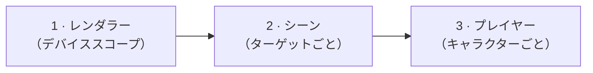

# デバイスロスト

GPU デバイスはアプリケーションの実行中に取り上げられることがあります（ドライバ更新、ノート PC の GPU 切替、
ブラウザタブのバックグラウンド化、GPU プロセスのクラッシュ）。この Player はどの Face でも、`.ssab` を
1 つも読み直さずに復帰できます。

## 規則：外側へ向かって作り直す

復帰は新しいデバイス上で、**この順の**3 ステップです：



1. **`SSRenderer::restore_device`** — パイプライン、サンプラー、バインドグループレイアウト。
2. **`SSScene::restore_device`** — 投影 uniform とフレームバッファ（ターゲットごと）。
3. **`SSPlayer::restore_textures`** — 各キャラクターが自分のアトラスを登録し直します。

順序は必然です。キャラクターは自分のアトラスを*レンダラーに*登録するので、テクスチャを渡す前に
新しいデバイス上のレンダラーが存在している必要があります。

再生状態（現在フレーム、ループ回数、再生制御）は CPU 側にあり、どこへも行っていません。巻き戻りません。

## Face ごと

=== "Rust"

    ```rust
    // 新しいデバイス上で、この順に：
    renderer.restore_device(&device, &queue);
    scene.restore_device(&device, &queue);
    for player in &mut players {
        player.restore_textures(&mut renderer, &device, &queue);
    }
    ```

    自前で wgpu を組まず `NativeHost`（生のウィンドウハンドル）を使っている Rust ホストは、
    `NativeHost::restore_device()` がこの手順一式をラップしています。

=== "C"

    ```c
    if (ss_scene_is_device_lost(scene)) {
        if (ss_scene_restore_device(scene) != SS_OK) {
            fprintf(stderr, "%s\n", ss_last_error());
        }
    }
    ```

    デバイスロスト中、`ss_scene_update` と `ss_scene_render` は何もせず、`ss_scene_resize` はサイズを
    記録するだけです。したがって確認しないホストでも、クラッシュではなくウィンドウが固まるだけになります。

=== "JavaScript"

    ```js
    import { restoreSharedDevice } from '@spritestudio/ssplayer-wgpu';

    if (ctx.isDeviceLost()) {
      await restoreSharedDevice(ctx);   // ページ上の全キャンバス・全プレイヤー
    }
    ```

    フレームループで確認してください。各サーフェスとプレイヤーが保持済みのソースから再構築され、
    止まったところから再生が続きます。**`<ss-player-webgpu>` はこれを自前でやります。**

=== "Bevy"

    復帰は Bevy 自身の復帰に乗ります。新しいデバイスで Bevy が `RenderStartup` を再実行してレンダラーが
    作り直され、キャラクターは次のフレームにメインワールドから読み直されます。

    **opt-in が必要です。** Bevy の既定のエラーハンドラはデバイスロストで*終了*するので、
    `RenderErrorPolicy::Recover` を返す `RenderErrorHandler` を入れてください。

## 復帰できないもの

**カラーフォーマットの変更はデバイスロストではなく、その場では復帰できません。** シーンのパイプラインは
構築時のフォーマットに対して焼かれているため、フォーマットが変わるなら `SSScene` を作り直します。

（Bevy アダプタだけは 1 つ例外を面倒見ています。カメラが HDR に切り替わるとビューのフォーマットが変わり、
その変化が起きたフレームでシーンがマスク用も含めてパイプラインを作り直します。）

## テストする

「今デバイスを失え」と言うポータブルな方法はありません。ブラウザならコンソールから `device.destroy()` が
最も近く、デスクトップならドライバのリセットや、実行中の discrete / integrated GPU 切り替えで起こせます。
出荷前に一度はやっておく価値があります。**扱わなかった場合の失敗は、固まったウィンドウか消えたウィンドウ**で、
しかも他人のマシンでしか再現しない類のバグだからです。

## 次に読む

* [借用モデル](../wgpu/borrow-model.md) — なぜ復帰がこの形なのか
* [パフォーマンス](./performance.md) — 再構築が効いたか確認できるカウンタ
