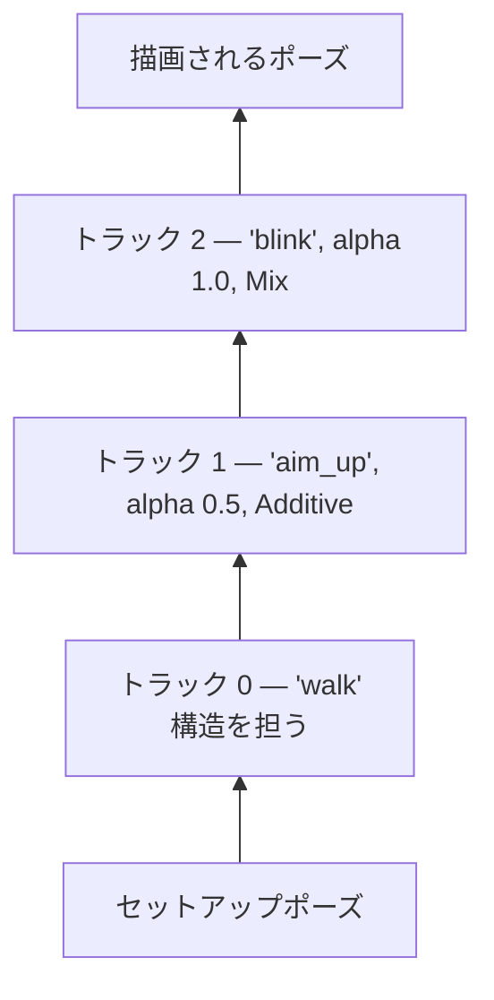

# モーションブレンディング

1 体のキャラクターで複数のアニメーションを同時に再生し、カットせずに移り変わります。下地に歩行、
その上に照準のオーバーレイ、さらにワンショットのリアクションをクロスフェードで — すべてアーティストが
別々にオーサリングしたファイルからです。

!!! info "現時点では Rust のみ"
    トラックスタックは Rust API にあります。C / JavaScript Face には公開されておらず、Bevy アダプタの
    3 コンポーネントからも届きません。このページの内容はすべて `SSPlayer` のものです。

## モデル：トラックのスタック

トラックは**セットアップポーズ**の上に、昇順に折り重なります。各トラックはアニメーション・**アルファ**
（下のポーズに対してどれだけ残るか）・**ブレンドモード**を持ちます。



**トラック 0 は特別です。** `set_animation` が確立するのがこれで、構造を担います — インスタンスツリーは
ここから構築されます。その上のトラックはオーバーレイです。

| ブレンドモード | 内容 |
|---|---|
| `TrackBlend::Mix` | そのトラックのポーズへ線形補間します。alpha 1 で完全に上書き |
| `TrackBlend::Additive` | **セットアップポーズからの差分**を加算するので、下のものが透けて残ります。照準・傾き・呼吸のためのモード |

## オーバーレイを載せる

```rust
use ssplayer_wgpu::TrackBlend;

player.set_animation("walk")?;          // トラック 0 — インスタンスツリーを再構築
player.play();

player.set_track_animation(1, "aim_up")?;      // オーバーレイ
player.set_track_blend(1, TrackBlend::Additive)?;
player.set_track_alpha(1, 0.5)?;               // 半分の強さ

// ... 外すとき
player.clear_track(1)?;
```

`clear_track` はトラック 0 を拒否します。代わりに alpha 0 へフェードしてください。キャラクターが
セットアップポーズへ収まります。

!!! warning "トラック 0 を設定するとスタックが作り直されます"
    `set_animation` はトラック 0 *とインスタンスツリー*を確立するので、載せていたオーバーレイも一緒に
    消えます。ベースのアニメーションを切り替えたら、オーバーレイを載せ直してください。

## カットではなくフェードする

どちらのフェードもシーンの `update` が進めます。開始したら、あとは描き続けるだけです。

```rust
// トラックの再生内容を、いまの状態から 400 ms かけて差し替える。
player.crossfade(0, "run", 400.0)?;

// トラックの alpha を 250 ms かけて動かす。
player.fade_track(1, 0.0, 250.0)?;    // オーバーレイを抜く
player.fade_track(0, 0.0, 600.0)?;    // キャラクター全体をセットアップポーズへ収める

if let Some(t) = player.track_fade_progress(0) { /* 0..1 */ }
player.cancel_track_fade(1)?;
```

!!! note "トラック 0 のクロスフェードはインスタンスツリーを再構築しません"
    それが「切り替え」ではなく「フェード」である理由です。ツリーは現在のアニメーションが構築したまま
    残ります。したがって**インスタンスパーツの構成が異なる**アニメーションへのクロスフェードは対象外です。
    その場合は `set_animation` を使い、カットを受け入れてください。

## トラックをスクラブする：連続値の制御

知っておく価値のあるテクニックです。制御軸そのものをアニメーションとしてオーサリングし（頭が左端から
右端まで振り向く、まぶたが開く）、それを*再生しません*。追従したい値で**スクラブ**します：

```rust
player.set_track_animation(1, "look_lr")?;
player.set_track_blend(1, TrackBlend::Additive)?;
player.set_track_speed(1, 0.0)?;             // 自動では進まない
player.set_track_frame(1, head_yaw_frame)?;  // ... あなたが動かす
```

こうすると、ブレンドを毎フレーム分オーサリングすることなく、顔がカメラやマウスに追従します。
アーティストは両端を作り、アプリケーションがその間の点を選びます。

## 実例の形

ゲーム内キャラクターでよくある 3 トラック構成：

| トラック | アニメーション | ブレンド | 駆動 |
|---|---|---|---|
| 0 | `idle` / `walk` / `run` | — | 状態変化時に `crossfade(0, …, 200.0)` |
| 1 | `aim_lr` | Additive、speed 0 | 照準角から `set_track_frame` |
| 2 | `hit_react` | Mix | `set_track_animation` ＋ `fade_track(2, 1.0, 80.0)`、完了時にフェードアウト |

いま何が載っているかは `track_count()` / `track_alpha(track)` / `track_blend(track)` /
`track_frame(track)` で確認できます。

## 2 つの制限

* **インスタンスの子はレイヤー化されません。** 別パックのアニメーションを再生するパーツは自分の再生
  コンテキストで動き、ルートのフレームのスロットから駆動されます。トラックは、あなたが持っている
  `SSPlayer` のキャラクターに対して働きます。
* トラックの **alpha** が強さです。1 つのトラックを複数のアニメーションが共有する場合、ソースの
  *weight* はそれらの比率を決めるだけで、2 つ目の音量つまみではありません。

## 実際に見る

`cargo run -p ssplayer-wgpu-viewer` でキーボードから全部触れます。クロスフェードがブレンドに見えるか
カットに見えるか、加算オーバーレイが下の芝居を残しているか — これは目でしか判定できないからです：

| キー | |
|---|---|
| `C` | トラック 0 を次のアニメーションへクロスフェード（400 ms） |
| `S` | トラック 1 に載せるアニメーションを巡回、または外す |
| `1` / `2` | トラック 1 の alpha を下げる／上げる |
| `A` | トラック 1 を mix / additive で切り替え |
| `0` | トラック 0 をセットアップポーズへフェードし、また戻す |
| `,` / `.` | トラック 1 のフレームをスクラブ — 上の「連続値の制御」 |

## 次に読む

* [再生と再生制御](./playback.md) — トラック 0 を駆動する再生制御
* [パフォーマンス](./performance.md) — 2 本目・3 本目のトラックのコスト
