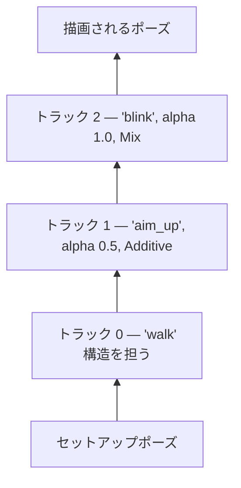

# モーションブレンディング

1 体のキャラクターで複数のアニメーションを同時に再生し、カットせずに移り変わります。下地に歩行、その上に照準のオーバーレイ、さらにワンショットのリアクションをクロスフェードで — すべてアーティストが別々にオーサリングしたファイルからです。

!!! info "現時点では Rust のみ"
    トラックスタックは Rust API にあります。C / JavaScript Face には公開されておらず、Bevy アダプタの
    3 コンポーネントからも届きません。このページの内容はすべて `SSPlayer` のものです。

## モデル：トラックのスタック

トラックは**セットアップポーズ**の上に、昇順に折り重なります。各トラックはアニメーション・**アルファ**（下のポーズに対してどれだけ残るか）・**ブレンドモード**を持ちます。



**トラック 0 は特別です。** `set_animation` が確立するのがこれで、構造を担います — インスタンスツリーはここから構築されます。その上のトラックはオーバーレイです。

| ブレンドモード | 内容 |
|---|---|
| `TrackBlend::Mix` | そのトラックのポーズへ線形補間します。alpha 1 で完全に上書き |
| `TrackBlend::Additive` | **セットアップポーズからの差分**を加算するので、下のものが透けて残ります。照準・傾き・呼吸のためのモード |

## オーバーレイを載せる

```rust
use ssplayer_wgpu::TrackBlend;

player.set_animation("walk")?;          // トラック 0 — インスタンスツリーを再構築
player.play();

player.set_track_animation(1, "aim_up")?;      // オーバーレイ
player.set_track_blend(1, TrackBlend::Additive)?;
player.set_track_alpha(1, 0.5)?;               // 半分の強さ

// ... 外すとき
player.clear_track(1)?;
```

`clear_track` はトラック 0 を拒否します。代わりに alpha 0 へフェードしてください。キャラクターがセットアップポーズへ収まります。

!!! warning "トラック 0 を設定するとスタックが作り直されます"
    `set_animation` はトラック 0 *とインスタンスツリー*を確立するので、載せていたオーバーレイも一緒に消えます。ベースのアニメーションを切り替えたら、オーバーレイを載せ直してください。

## カットではなくフェードする

どちらのフェードもシーンの `update` が進めます。開始したら、あとは描き続けるだけです。

```rust
// トラックの再生内容を、いまの状態から 400 ms かけて差し替える。
player.crossfade(0, "run", 400.0)?;

// トラックの alpha を 250 ms かけて動かす。
player.fade_track(1, 0.0, 250.0)?;    // オーバーレイを抜く
player.fade_track(0, 0.0, 600.0)?;    // キャラクター全体をセットアップポーズへ収める

if let Some(t) = player.track_fade_progress(0) { /* 0..1 */ }
player.cancel_track_fade(1)?;
```

!!! note "トラック 0 のクロスフェードはインスタンスツリーを再構築しません"
    それが「切り替え」ではなく「フェード」である理由です。ツリーは現在のアニメーションが構築したまま残ります。したがって**インスタンスパーツの構成が異なる**アニメーションへのクロスフェードは対象外です。その場合は `set_animation` を使い、カットを受け入れてください。

## 1 つのトラックで 2 つのアニメーションを混ぜる

1 つのトラックには、複数のアニメーションを載せて **weight** で混ぜられます。キャラクターの移動速度に応じて歩きと走りを混ぜる、といった使い方です。載せた 1 つ 1 つを*ソース*と呼び、ハンドルで指定します：

```rust
player.set_animation("walk")?;
player.play();
let walk = player.track_main_source(0).unwrap();
let run = player.add_track_source(0, "run", 0.0)?;   // 歩きの横に、いまは無音で載せる

// 毎フレーム、キャラクターの速度から
player.set_source_weight(walk, 1.0 - t)?;
player.set_source_weight(run, t)?;
```

* weight は**トラックの中での比率**です。`(0.7, 0.3)` と `(7, 3)` は同じ混ざり方になります。トラックの強さは、引き続き alpha で決めます。
* 尺の違う歩きと走りは、だんだんずれていきます。トラックの同期を `TrackSync::Start` にしてから走りを載せる（下の節）と、歩調をそろえて始められます。または `set_source_frame` でシークしてください。
* イベントを発火するのは、トラック 0 の主ソースだけです。他のソースにも発火させるには、`set_source_event_threshold` でしきい値をそのソースの weight 以下に下げます。
* ハンドルは、そのソースが解放されるまで有効です。解放されるのは、クロスフェードの完了、`clear_track`、`set_animation` のときです。

## トラック 0 と歩調をそろえて始める

トラックに載せたアニメーションは、再生区間の先頭から始まります。歩幅の途中にいる歩きの上に走りを載せると、足の運びが食い違います。トラックの**同期**を `TrackSync::Start` にすると、そのあと載せたアニメーションは、トラック 0 がいる**位相**から始まります。位相とは、再生区間のどこまで進んだかを、先頭を 0.0、終端に向かって 1.0 とした割合で表したものです。尺の違うアニメーションも、割合でそろいます：

```rust
use ssplayer_wgpu::TrackSync;

player.set_track_sync(0, TrackSync::Start)?;   // 載せる前に設定する
player.crossfade(0, "run", 400.0)?;            // 走りは歩きと同じ位相から始まる
```

| 同期 | 載せたアニメーションの開始位置 | 向いている使い方 |
|---|---|---|
| `TrackSync::Free`（既定） | 再生区間の先頭 | 一回きりの動き（まばたき、口の形、被弾リアクションなど） |
| `TrackSync::Start` | トラック 0 のアニメーションと同じ、再生区間の中の割合の位置 | 周期的な動きどうしを重ねる（歩きと走りなど） |

* そのあとトラックに載せるすべての操作に効きます。`set_track_animation`・`crossfade`・`add_track_source` で、トラック 0 でも効きます（入ってくるアニメーションは、出ていくアニメーションの位相から始まります）。
* そろえるのは、アニメーションを載せたときの**1 回だけ**です。その後は両方が 1 つの時計で進むので、尺と速度が同じなら歩調はそろったままです。尺や速度が違えば、またずれていきます。
* alpha や blend と同じく、トラックの設定です。`set_animation` はすべてのトラックを `Free` に戻すので、ベースのアニメーションを切り替えたら設定し直してください。

## トラックをスクラブする：連続値の制御

制御軸そのものをアニメーションとしてオーサリングし（頭が左端から右端まで振り向く、まぶたが開く）、それを*再生しません*。追従したい値で**スクラブ**します：

```rust
player.set_track_animation(1, "look_lr")?;
player.set_track_blend(1, TrackBlend::Additive)?;
player.set_track_speed(1, 0.0)?;             // 自動では進まない
player.set_track_frame(1, head_yaw_frame)?;  // ... あなたが動かす
```

こうすると、ブレンドを毎フレーム分オーサリングすることなく、顔がカメラやマウスに追従します。アーティストは両端を作り、アプリケーションがその間の点を選びます。

## 実例の形

ゲーム内キャラクターでよくある 3 トラック構成：

| トラック | アニメーション | ブレンド | 駆動 |
|---|---|---|---|
| 0 | `idle` / `walk` / `run` | — | 状態変化時に `crossfade(0, …, 200.0)` |
| 1 | `aim_lr` | Additive、speed 0 | 照準角から `set_track_frame` |
| 2 | `hit_react` | Mix | `set_track_animation` ＋ `fade_track(2, 1.0, 80.0)`、完了時にフェードアウト |

いま何が載っているかは `track_count()` / `track_alpha(track)` / `track_blend(track)` /
`track_sync(track)` / `track_frame(track)` で確認できます。

## 2 つの制限

* **インスタンスの子はレイヤー化されません。** 別パックのアニメーションを再生するパーツは自分の再生コンテキストで動き、ルートのフレームのスロットから駆動されます。トラックは、あなたが持っている
  `SSPlayer` のキャラクターに対して働きます。
* トラックの **alpha** が強さです。1 つのトラックを複数のアニメーションが共有する場合、ソースの
  *weight* はそれらの比率を決めるだけで、2 つ目の音量つまみではありません。

## 実際に見る

`cargo run -p ssplayer-wgpu-viewer` でキーボードから全部触れます。クロスフェードがブレンドに見えるかカットに見えるか、加算オーバーレイが下の芝居を残しているか — これは目でしか判定できないからです：

| キー | |
|---|---|
| `C` | トラック 0 を次のアニメーションへクロスフェード（400 ms） |
| `S` | トラック 1 に載せるアニメーションを巡回、または外す |
| `1` / `2` | トラック 1 の alpha を下げる／上げる |
| `A` | トラック 1 を mix / additive で切り替え |
| `0` | トラック 0 をセットアップポーズへフェードし、また戻す |
| `,` / `.` | トラック 1 のフレームをスクラブ — 上の「連続値の制御」 |
| `Y` | トラックの同期を free / start で切り替え（キャスト全体） — `C` と `S` を両方の設定で見比べる |

## 次に読む

* [再生と再生制御](./playback.md) — トラック 0 を駆動する再生制御
* [パフォーマンス](./performance.md) — 2 本目・3 本目のトラックのコスト
