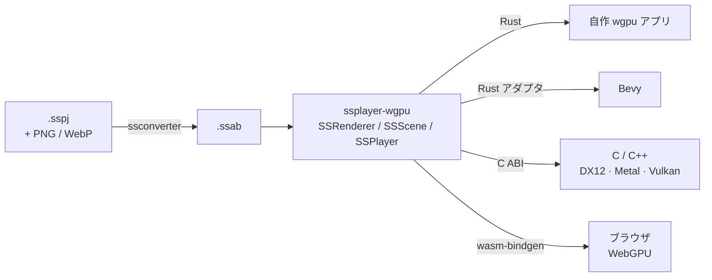

# 🦀 SSPlayer for wgpu

**[SpriteStudio](https://www.webtech.co.jp/spritestudio/)** のアニメーション（`.ssab`）を
[wgpu](https://wgpu.rs/) で再生します。レンダラーもシェーダーも 1 つ、呼び方が 4 通り。モーションは
専用エディタでアーティストが作り、あなたはファイルを読み込んで再生するだけです。動画ファイルも、
作り直しも、エンジンへのロックインもありません。

wgpu は **WebGPU / Vulkan / DirectX 12 / Metal** を 1 つの API の裏に置きます。ブラウザのキャンバスも、
Windows のゲームも、macOS のアプリも、4 本の移植版ではなく同じライブラリ 1 本で賄えるのはそのためです。

!!! tip "SpriteStudio のデータが手元に無くても始められます"
    [公式のサンプルデータ](https://www.webtech.co.jp/help/ja/spritestudio7/download/sample/)がそのまま使えます。キャラクターなら
    [Ringo](https://www.webtech.co.jp/help/ja/spritestudio7/download/sample/#ringo)、エフェクトを含むものなら
    [パーティクル](https://www.webtech.co.jp/help/ja/spritestudio7/download/sample/#Perticle_sample) が手頃です。

## 🚀 ここから始める

同じライブラリの呼び方が 4 通りあります。**自分のアプリが書かれている言語**のものを選んでください。
各パスはそれ単体で完結していて、他の 3 つを読む必要はありません。

-   :material-language-rust: __Rust__

    ---

    `wgpu::Device` とレンダーパスを自分で持っているケース（自作レンダラー、`winit`、`egui`、`Slint`）。
    あなたが開いたパスの中に描画します。

    [:octicons-arrow-right-24: Rust ではじめる](./start/rust.md)

-   :material-gamepad-variant: __Bevy__

    ---

    プラグインを 1 つ追加して、コンポーネントを 3 つ spawn するだけ。Bevy が既に持っているデバイス上で、
    Bevy 自身の 2D パスに描画されます。wgpu には一切触れません。

    [:octicons-arrow-right-24: Bevy ではじめる](./start/bevy.md)

-   :material-language-cpp: __C / C++__

    ---

    静的ライブラリ 1 本とヘッダ 1 枚。`HWND` / `CAMetalLayer` / `Window` / `wl_surface` を渡して、
    毎フレーム 2 つの関数を呼ぶだけ。裏側は DX12 / Metal / Vulkan です。
    **wgpu の型は ABI を一切越えません。**

    [:octicons-arrow-right-24: C / C++ ではじめる](./start/cpp.md)

-   :material-web: __JavaScript / TypeScript__

    ---

    WebGPU レンダラーを WebAssembly にコンパイルした npm パッケージ。1 体だけ表示するなら
    `<ss-player-webgpu>` 要素で済みます。デバイスはライブラリ側が用意します。

    [:octicons-arrow-right-24: Web ではじめる](./start/web.md)

どれを選んでも `.ssab` が必要です — [アセットの準備](./start/assets.md)を参照してください。試すだけなら
自前のデータは不要です。すべてのサンプルは SDK 付属のテストアニメーションで動きます。

▶️ **まず動いているところを見たい場合**：<a href="../demo/" target="_blank" rel="noreferrer">WebGPU デモ</a>
がこのドキュメントと一緒に公開されています。インストール不要（WebGPU 対応ブラウザが必要）。
ページは 3 つ：API の 2 つの形、<a href="../demo/element.html" target="_blank" rel="noreferrer">カスタム要素</a>
単体、そして<a href="../demo/multi.html" target="_blank" rel="noreferrer">それを 1 ページに並べたもの</a>
（他の要素と重ねても `GPUDevice` は 1 つ）。

## 🧭 このドキュメントの構成

| セクション | 誰が読むか |
|---|---|
| **[はじめる](./start/rust.md)** | 全員が **1 回だけ**。ホストごとに 4 本の短いパスがあり、それぞれが単体で完結します（導入 → ロード → 再生 → フレームループ）。選択が発生するのはここだけです |
| **[ガイド](./guide/concepts.md)** | 以降は全員が同じ本文を読みます。コードは言語別タブになっていて、どこかのページで 1 度選べばサイト全体がその言語で表示されます |
| **[API リファレンス](./reference/rust.md)** | 名前を正確に知りたいとき。Face ごとに 1 ページ |
| **[wgpu ホスト](./wgpu/borrow-model.md)** | **デバイスを自分で持っている人だけ** — Rust アプリかエンジンアダプタ。C++ / ブラウザの読者はこのセクションに入る必要がありません |
| **[開発者向け](./contributing/index.md)** | ライブラリの全 Face を手元でビルドする手順と、変更が守るべきルール |

本文とは別に、<a href="../api/" target="_blank" rel="noreferrer">Rust API リファレンス</a>（`ssplayer_wgpu` と
`ssplayer_bevy` の rustdoc）と <a href="../demo/" target="_blank" rel="noreferrer">WebGPU デモ</a>
が同じサイト上に公開されています。ナビゲーションバーからも辿れます。

## 📦 成果物

ライブラリは 1 つ、パッケージは 4 つ。**まだどれも公開されていません** — 現時点ではすべてソースから
ビルドする経路になります。何が公開の条件かは各ページに書いてあります。

| Face | 公開形態 | 状況 |
|---|---|---|
| Rust | crates.io の `ssplayer-wgpu` | 🚧 先に SDK のクレート公開が必要 |
| Bevy | crates.io の `ssplayer-bevy` | 🚧 同上（＋ Player 本体の公開） |
| C / C++ | GitHub Releases の `ssplayer-wgpu-<platform>.zip`（`include/` `lib/` `LICENSE.md` `LICENSE.ja.md`） | 🚧 ワークフローはあるがリリース未実施 |
| Web | npm の `@spritestudio/ssplayer-wgpu` | 🚧 npm 未公開 |

## 🗺️ エディタから画面まで

コンバートは**事前**に行います。この Player は実行時に一切変換せず、コンバータも同梱しません。
[アセットの準備](./start/assets.md)を参照してください。

## 🔗 関連

- [SpriteStudio Docs](https://cri-middleware.github.io/SpriteStudio-Docs/) — SDK と全公式 Player のポータル。
- [SpriteStudio-SDK](https://github.com/cri-middleware/SpriteStudio-SDK) — この Player が直接リンクする
  共通コア（`ssruntime` / `ssab`）。
- [SSPlayerForWeb](https://github.com/cri-middleware/SSPlayerForWeb) — WebGL Player。本 Player の描画パリティの
  基準であり、WebGPU が無い環境での答えでもあります。
- [SSConverterGUI](https://github.com/cri-middleware/SSConverterGUI) — デスクトップ版コンバータ。
